# Hotel Reservation & Payment System: Database Schema v4.1 (final)

**What changed in v4.1 (compared with v4.0)**

A review of v4.0 found contradictions and missing constraints. Nothing has been created in Neon yet, so these are design changes, not migrations. The v4.0 list further down is kept for history.

*Fixes*
- `data_requests.status` is now `varchar(30)` (`AWAITING_VERIFICATION` did not fit in 20).
- A refund of a cash, transfer or external-card payment is created by the system as `PENDING` with no employee. `recorded_by_id` is now required only once a `MANUAL` row is `SUCCEEDED`.
- Refund rows never carry `provider_payment_intent_id` (it would collide with the original payment's unique value).
- `checkout_intents.id` must be a random UUID, not a time-ordered one.
- Audit rows for reservations can be anonymized by one dedicated database role, `retention_job`. Nobody else can update them.
- A room's `room_type_id` cannot change once a reservation has used the room. Retype by retiring the room and creating a new one.
- A room cannot be retired while an `APPROVED` reservation on or after today holds it.
- Overlapping unreleased room blocks on the same room are rejected by an exclusion constraint.

*New constraints*
- Guests: `adults >= 1`, `children >= 0`. Amounts are `>= 0` everywhere. `payments.amount_minor > 0`. `room_types.max_guests > 0`.
- State consistency: cancellation columns only on `CANCELLED`, `source`/`created_by_id` biconditional, invoice void columns, review hide columns, token consumed/revoked, `SUCCEEDED` payments have `paid_at`.
- Lower-case, phone, country code, locale and enum `CHECK`s on every such column (Conventions).
- Money and relationships: currency must match through composite FKs. A refund trigger checks the original payment (type, reservation, currency, provider, method, total refunded). A dispute trigger checks the payment. Deferred trigger checks that nights, tax lines and totals add up. Legal-version type trigger.
- `approval_requests`: the requester cannot decide their own request. Composite FKs to the reservation's branch and currency and to the target room's branch.
- `tax_rules`: rate and amount ranges, and no overlapping validity periods for the same code.
- `system_settings`: explicit global-row check and upper bounds.
- `branches.timezone` is validated against `pg_timezone_names` and locked once the branch has reservations.
- Delete and update protection extended to the other append-only or never-deleted tables.

*New rules*
- Check-in requires the "ID verified?" button (`id_verified_at`).
- Email codes: at most 3 codes requested per checkout intent in 15 minutes, and at most 5 wrong guesses per code. New column `guest_tokens.attempts`.
- Refunds lock the original payment, are refused on `DISPUTED` or `CHARGED_BACK` payments, and a failed Stripe refund is handled (`REFUND_FAILED`).
- Folio charges only while the guest is checked in.
- Invoice numbers come from a counter table, `invoice_counters` (table 39), so numbers are gapless.
- Email dedupe keys include a date, so a rescheduled booking still gets its reminder. Emails that never send are deleted after 90 days.
- The availability query ignores branches that are not `ACTIVE`.

**What changed (compared with v3.1)**

This version follows the project documentation v0.3. Nothing has been created in Neon yet, so these are changes to the design, not migrations.

- Role `ADMIN` is now `SUPER_ADMIN`. Roles: `RECEPTIONIST`, `SUPERVISOR`, `MANAGER`, `SUPER_ADMIN`.
- Room types belong to a branch, not a building. A guest never picks a building. Rooms carry `branch_id` and may sit in any building of the branch. `room_types.building_id` is removed.
- One nightly price per room type. Weekend pricing is removed: the `weekend_nights` setting, `room_types.weekend_price_minor` and `reservation_nights.rate_type`. `base_price_minor` is renamed `price_minor`.
- No cancellation fee, no free-cancellation window and no fee waivers. Cancelling before check-in and every no-show are refunded in full, automatically, with no approver. The no-show notice columns (`guest_notified_*`) and the refund eligibility rule are gone.
- A `PENDING` reservation is cancelled automatically when its check-in date ends (code `PENDING_EXPIRED`) and anything paid is refunded. The daily overdue notification is gone. One job, every 15 minutes, handles both no-shows and expired `PENDING` reservations.
- Guests cannot change dates or guest counts. Staff can. `reschedule_count` is now `date_change_count` and counts every staff date change. A Receptionist gets 2 per reservation. Further changes need a Supervisor or higher, with a reason (not enforced by a database CHECK).
- `required_payment_minor` is set at booking and never recalculated. The balance is always worked out as total plus charges minus net paid.
- Money flow for early checkout, extension, shortening, reschedule and room-type change is defined in section 7.
- Payments: new method `CARD_EXTERNAL` (a record of a card payment taken on a separate terminal). A reference is required for bank transfers and external cards. Receipts are private files: `proof_url` is replaced by `proof_public_id`. Refunds carry a `refund_reason` code.
- Three new tables: `checkout_intents` (booking details saved before payment; only the intent id goes to Stripe), `guest_tokens` (manage links, history links, history sessions, privacy verification links, 6-digit email codes) and `approval_requests` (goodwill refunds and room-type changes). Manage links moved from `reservations.manage_token_hash` to `guest_tokens`. 38 tables.
- The cancellation policy is a third legal document. Reservations store `cancellation_policy_version_id`.
- `cancellation_code` (new) records why a reservation was cancelled. Codes include `PENDING_EXPIRED` and `BRANCH_CLOSED`.
- Reviews: a Super Admin can unhide a review that a Branch Manager or Super Admin hid.
- Settings: `max_advance_booking_days` defaults to 5. `down_payment_bps` is 0 (off) or at least 3000. The Supervisor refund limit exists only on branch rows, in the branch currency.
- Password reset links last 10 minutes. A password reset does not clear an account lock.
- Data requests: `DELETION` is renamed `ANONYMIZATION`, and a request is rejected while the email has an open outstanding balance.
- New jobs: inventory maintenance and checkout-intent cleanup.
- Removed columns: `reservations.manage_token_hash`, `free_cancellation_until`, `late_cancellation_fee_bps`, `cancellation_fee_minor`, `guest_notified_*`; `system_settings.free_cancellation_hours`, `late_cancellation_fee_bps`, `weekend_nights`; `payments.proof_url`.
- Renamed: `base_price_minor` > `price_minor`, `reschedule_count` > `date_change_count`, `proof_url` > `proof_public_id`, `DataRequestType.DELETION` > `ANONYMIZATION`, notification `NO_SHOW_REFUND_PENDING` > `REFUND_TO_RECORD`.

PostgreSQL (Neon) · Spring Boot (JPA, Flyway) · Next.js. 39 tables.

**Who has a login:** employees only. Guests do not have accounts. They book as guests, and every reservation stores the guest's details and a private link for managing the booking.

**Left out on purpose:** guest accounts, multi-room bookings, seasonal and weekend rates (one nightly price per room type), promo codes, cancellation and no-show fees, companion guest names, branch descriptions and map data.

## Contents

1. Conventions
2. ERD
3. Table index
4. Table definitions
5. Availability query
6. Data retention
7. Rules for the new features
8. Enums reference

---

## 1. Conventions

In the definitions, **Req** means `NOT NULL`. These rules apply to every table.

| Topic | Rule |
| --- | --- |
| Primary keys | `uuid` generated by the application (UUIDv7 preferred). |
| Names | `snake_case`, plural table names, singular column names, foreign keys named `<table_singular>_id`. |
| Money | `bigint` minor units, column suffix `_minor`, next to a `currency char(3)` with `CHECK (currency ~ '^[A-Z]{3}$')`. Never `float`. |
| Rates | Integer basis points. 1% = 100. |
| Timestamps | `timestamptz` in UTC. |
| Stay dates | `date`, meaning the calendar date in the branch timezone. |
| Enums | `varchar` plus `CHECK (col IN (...))`, mapped with `@Enumerated(EnumType.STRING)`. No native PostgreSQL enums. |
| Locking | `version bigint NOT NULL DEFAULT 0` with `@Version` on mutable tables. |
| Deletion | Foreign keys default to `ON DELETE RESTRICT`. `CASCADE` only where a parent fully owns its rows. |
| Locale codes | BCP 47 tags such as `en`, `en-US`, `pt-BR`. Validate with `CHECK (locale ~ '^[a-z]{2,3}(-[A-Za-z0-9]{2,8})*$')`. |
| Emails | Stored lower-case, with `CHECK (col = lower(col))` on every email column. |
| Phone numbers | E.164. `CHECK (col IS NULL OR col ~ '^\+[1-9][0-9]{6,14}$')`. |
| Country codes | `CHECK (col IS NULL OR col ~ '^[A-Z]{2}$')`. |
| Enum columns | Every enum column has its own `CHECK (col IN (...))` listing the values of section 8, even where the table definition below does not repeat it. |
| Append-only tables | `audit_logs`, `marketing_consents` and `legal_document_versions` reject every `UPDATE` and `DELETE` through triggers (see "Delete and update protection"). Only the `retention_job` database role may update them, for anonymization. |
| Email and locale `CHECK`s | Apply the email, phone, country and locale checks to every such column, including `reservations`, `checkout_intents`, `employees`, `email_outbox` and `legal_document_versions`. |
| Extensions | `btree_gist` (reservation exclusion constraint). |

**Common columns.** These names appear in many tables and always mean the same thing.

| Column pattern | Meaning |
| --- | --- |
| `version` | A counter that goes up by 1 on every save. If two people edit the same row at once, the second save is rejected instead of silently overwriting the first (optimistic locking). |
| `created_at`, `updated_at` | When the row was first saved and when it was last changed. Set by the application, never typed in. |
| any `*_at` column | The moment something happened, for example `paid_at` or `cancelled_at`. Null means it has not happened yet, so these columns often double as a yes/no flag. |
| `*_minor` | An amount of money in the smallest unit of the currency, as a whole number: 1250 in a `PHP` row means 12.50 pesos. "Minor" here has nothing to do with a child. |
| `*_bps` | A percentage in basis points: 100 = 1%, 1200 = 12%, 10000 = 100%. |
| `*_hash` | A one-way fingerprint (SHA-256 or BCrypt) of a secret such as a password or link token. Only the fingerprint is stored, so a database leak does not reveal the secret. |
| `ip_address`, `user_agent` | Where a request came from and which browser or app sent it (for example `Mozilla/5.0 ...`). Optional and personal data, so only kept where there is a reason, such as proof of consent. |
| `idempotency_key` | A random id the client sends with a create request. If the same request is sent twice (a retry), the second one returns the first result instead of creating a duplicate. |
| `entity_type` + `entity_id` | A pointer to a row in any table (for example `RESERVATION` and its id) without a real foreign key, so one log or notification table can refer to everything. |
| `params`, `payload`, `before_data`, `after_data`, `line_items` | `jsonb` columns holding a small structured snapshot: template values, a raw event, a row before and after a change, or invoice lines. |
| `locale` | A language tag such as `en` or `pt-BR`. Decides which language is shown or emailed. |

---

## 2. ERD

Relationships between tables. `||` means exactly one, `o|` means zero or one, `o{` means zero or many. Renders on GitHub and most Markdown viewers that support Mermaid.

```mermaid
erDiagram
    branches ||--o{ buildings : "has"
    branches |o--o{ employees : "staff work at"
    branches ||--o{ tax_rules : "defines"
    branches |o--o| system_settings : "optional overrides"
    branches ||--o{ reservations : "receives"

    branches ||--o{ room_types : "offers"
    buildings ||--o{ rooms : "contains"
    themes ||--o{ room_types : "styles"
    room_types ||--o{ rooms : "has"
    room_types ||--o{ room_type_inventory : "counted per night"
    room_types ||--o{ room_images : "shows"
    room_types ||--o{ room_type_amenities : "has"
    amenities ||--o{ room_type_amenities : "listed in"
    rooms ||--o{ room_blocks : "blocked by"

    room_types ||--o{ room_type_translations : "translated by"
    themes ||--o{ theme_translations : "translated by"
    amenities ||--o{ amenity_translations : "translated by"

    room_types ||--o{ reservations : "booked as"
    rooms |o--o{ reservations : "assigned on approval"
    employees |o--o{ reservations : "enters walk-ins"
    employees |o--o{ reservations : "approves"
    reservations ||--o{ reservation_nights : "priced by"
    reservations ||--o{ reservation_tax_lines : "taxed by"
    reservations ||--o{ payments : "paid by"
    reservations ||--o{ folio_charges : "extras"
    reservations ||--o{ invoices : "billed by"
    reservations ||--o| outstanding_balances : "may owe"
    reservations ||--o| reviews : "reviewed by"
    employees |o--o{ reviews : "hides"
    employees |o--o{ outstanding_balances : "writes off"
    payments |o--o{ payments : "refunded by"
    payments ||--o{ payment_disputes : "disputed as"

    employees ||--o{ verification_tokens : "receives"
    employees ||--o{ refresh_tokens : "holds"
    employees ||--o{ notifications : "receives"
    employees |o--o{ email_outbox : "is emailed"
    employees |o--o{ audit_logs : "performs"
    employees |o--o{ data_requests : "handles"

    legal_document_versions |o--o{ reservations : "terms, privacy and cancellation policy accepted"
    legal_document_versions |o--o{ marketing_consents : "policy shown"
    reservations |o--o{ marketing_consents : "given during"

    branches ||--o{ checkout_intents : "starts"
    room_types ||--o{ checkout_intents : "requested"
    checkout_intents |o--o| reservations : "becomes"
    reservations ||--o{ guest_tokens : "manage links"
    checkout_intents ||--o{ guest_tokens : "email codes"
    data_requests ||--o{ guest_tokens : "verification links"
    reservations ||--o{ approval_requests : "needs approval"
    employees |o--o{ approval_requests : "requests and decides"
    approval_requests |o--o{ payments : "refund created from"
```



`processed_webhook_events`, `shedlock` and `invoice_counters` have no relationships in the diagram; they are standalone tables (webhook dedupe, job locks and invoice numbering; `invoice_counters.branch_id` is a plain FK to `branches`). `data_requests` and `marketing_consents` are linked to guests by email address, not by a foreign key.

---

## 3. Table index

| # | Table | Group | Purpose |
| --- | --- | --- | --- |
| 1 | `employees` | Identity | Every login: receptionists, supervisors, managers and super admins. |
| 2 | `verification_tokens` | Identity | Employee invitation and password reset links. |
| 3 | `refresh_tokens` | Identity | Revocable employee sessions with reuse detection. |
| 4 | `legal_document_versions` | Privacy | Published versions of the terms, privacy policy and cancellation policy. |
| 5 | `marketing_consents` | Privacy | Append-only log of marketing email consent by email address. |
| 6 | `data_requests` | Privacy | Guest data export and anonymization requests. |
| 7 | `branches` | Property | A hotel location with country, timezone and currency. |
| 8 | `buildings` | Property | A building inside a branch. |
| 9 | `themes` | Property | Room design themes. |
| 10 | `room_types` | Property | A bookable category × theme in one branch, with its nightly price. |
| 11 | `rooms` | Property | Physical rooms (in a building of the branch) and their timed cleaning state. |
| 12 | `room_blocks` | Property | Date ranges when a room cannot be sold. |
| 13 | `amenities` | Property | Master list of amenities. |
| 14 | `room_type_amenities` | Property | Links room types to amenities. |
| 15 | `room_images` | Property | Cloudinary gallery per room type. |
| 16 | `room_type_inventory` | Property | Rooms available per room type per night. |
| 17 | `room_type_translations` | Translation | Room type names and descriptions per language. |
| 18 | `theme_translations` | Translation | Theme names and descriptions per language. |
| 19 | `amenity_translations` | Translation | Amenity names per language. |
| 20 | `tax_rules` | Tax | Taxes and fees charged by a branch. |
| 21 | `reservations` | Booking | A booking with guest, price, approval and lifecycle. |
| 22 | `reservation_nights` | Booking | One row per night with the rate charged. |
| 23 | `reservation_tax_lines` | Booking | Taxes applied to a reservation, copied at booking time. |
| 24 | `payments` | Money | Payments and refunds. |
| 25 | `payment_disputes` | Money | Chargebacks raised against a payment. |
| 26 | `folio_charges` | Money | Extra charges during a stay. |
| 27 | `invoices` | Money | Issued invoice snapshots. |
| 28 | `processed_webhook_events` | Money | Stripe event ids already handled. |
| 29 | `system_settings` | Platform | Policy settings, global with branch overrides. |
| 30 | `audit_logs` | Platform | Append-only record of who changed what, including every reservation edit. |
| 31 | `notifications` | Platform | In-app notification feed for employees. |
| 32 | `email_outbox` | Platform | Emails waiting to be sent, with retry tracking. |
| 33 | `outstanding_balances` | Money | Unpaid balances after checkout; blocks new bookings by email while open. |
| 34 | `reviews` | Booking | One guest rating and comment per completed stay. |
| 35 | `checkout_intents` | Booking | Booking details saved before payment or the email code, so a payment can always become a reservation. |
| 36 | `guest_tokens` | Booking | Secret links and codes for guests: manage, history, history session, privacy verification, email code. |
| 37 | `approval_requests` | Money | Goodwill refunds and room-type changes waiting for a Supervisor or higher. |
| 38 | `shedlock` | Platform | Lock table that keeps each scheduled job running on one instance at a time. |
| 39 | `invoice_counters` | Money | Last invoice number used per branch and year, so numbers have no gaps. |

---

## 4. Table definitions

### Identity and access

#### 1. employees

Every person who can sign in. Guests have no account. The `role` decides what an employee may do. New employees are created by a Branch Manager or Super Admin in the `PENDING` state, cannot sign in, and become `ACTIVE` when they set their own password through an emailed link (section 7). A Branch Manager can invite receptionists and supervisors for their own branch; a Super Admin can invite any role. Status flow: `PENDING` to `ACTIVE`, `ACTIVE` to `SUSPENDED` and back, and `DEACTIVATED` is final. Sign-in history is not stored in the database (section 7, Login events).

| Column | Type | Req | Purpose and rules |
| --- | --- | --- | --- |
| `id` | uuid | Yes | Primary key. |
| `role` | varchar(20) | Yes | `EmployeeRole`. Drives all authorization. |
| `branch_id` | uuid | No | FK to `branches`. The branch the employee works at. Null only for Super Admins. |
| `full_name` | varchar(150) | Yes | Display name. |
| `email` | varchar(254) | Yes | The login name. Stored lower-case, so addresses that differ only by capitalization are the same account. |
| `phone` | varchar(20) | No | E.164, for example `+639171234567`. |
| `password_hash` | varchar(100) | No | BCrypt hash. Null until the invitation is accepted. Never log or return it. |
| `status` | varchar(20) | Yes | `EmployeeStatus`. Only `ACTIVE` can sign in. |
| `failed_login_count` | int | Yes | Wrong passwords in a row. Default 0, reset to 0 on a successful sign-in. Reaching the limit sets `locked_until`. |
| `locked_until` | timestamptz | No | Sign-in is refused until this time, after too many wrong passwords. Null = not locked. The lock ends only when this time passes: nobody can unlock early, and a password reset does not clear it. |
| `last_login_at` | timestamptz | No | Time of the most recent successful sign-in. Null = never signed in. Only the latest time is kept here; sign-in history is in the logging stack. |
| `preferred_locale` | varchar(10) | Yes | Default `en`. Language of the staff interface and staff emails. |
| `version`, `created_at`, `updated_at` | bigint, timestamptz, timestamptz | Yes | `version` counts saves so two people editing at once cannot overwrite each other; `created_at` and `updated_at` are the first-save and last-save times. |

Constraints and indexes:
- `CREATE UNIQUE INDEX employees_email_lower_key ON employees (lower(email))`: unique regardless of capitalization.
- `CHECK (email = lower(email))`.
- `CHECK (status IN ('PENDING','ACTIVE','SUSPENDED','DEACTIVATED'))`.
- `CHECK (role IN ('RECEPTIONIST','SUPERVISOR','MANAGER','SUPER_ADMIN'))`.
- `CHECK ((role = 'SUPER_ADMIN') = (branch_id IS NULL))`: Super Admins are company-wide, everyone else belongs to a branch.
- `CHECK (status IN ('PENDING','DEACTIVATED') OR password_hash IS NOT NULL)`: only an account that never set a password may lack one.
- `INDEX (branch_id) WHERE branch_id IS NOT NULL`.

#### 2. verification_tokens

Single-use links for accepting an invitation or resetting a password. Tokens are long random values, so guessing them is not realistic and no attempt counter is needed. Opening the link only shows the "set password" page; the token is consumed when the new password is submitted, so a mail scanner that opens links cannot use it up. Setting a password through an `INVITE` token also proves the employee owns the email address and moves the account from `PENDING` to `ACTIVE`.

| Column | Type | Req | Purpose and rules |
| --- | --- | --- | --- |
| `id` | uuid | Yes | Primary key. |
| `employee_id` | uuid | Yes | FK to `employees`, `ON DELETE CASCADE`. |
| `purpose` | varchar(30) | Yes | `VerificationPurpose`. A token for one purpose never works for another. |
| `token_hash` | char(64) | Yes | SHA-256 of the raw token. The raw token only appears in the emailed link. |
| `expires_at` | timestamptz | Yes | When the link stops working: invitation links expire after 48 hours and password reset links after 10 minutes. An expired token is rejected even if unused. |
| `consumed_at` | timestamptz | No | Set on use. A consumed token is dead. |
| `revoked_at` | timestamptz | No | Set when a newer token for the same employee and purpose is issued (a resend). A revoked token is dead. |
| `created_at` | timestamptz | Yes | Also used for the resend cooldown. |

Constraints and indexes:
- `UNIQUE (token_hash)`.
- `CHECK (purpose IN ('INVITE','PASSWORD_RESET'))`.
- `CHECK (consumed_at IS NULL OR revoked_at IS NULL)`.
- `UNIQUE (employee_id, purpose) WHERE consumed_at IS NULL AND revoked_at IS NULL`: at most one live token per purpose, so a resend must revoke the older one in the same transaction.
- `INDEX (employee_id, purpose, created_at DESC)`.

#### 3. refresh_tokens

One row per issued refresh token, so sessions can be rotated and revoked.

| Column | Type | Req | Purpose and rules |
| --- | --- | --- | --- |
| `id` | uuid | Yes | Primary key. |
| `employee_id` | uuid | Yes | FK to `employees`, `ON DELETE CASCADE`. |
| `family_id` | uuid | Yes | Groups every token descended from one login. |
| `token_hash` | char(64) | Yes | SHA-256 of the raw token. |
| `replaced_by_id` | uuid | No | Self FK. Set when rotated. Reuse of a rotated token means theft: revoke the family. |
| `expires_at` | timestamptz | Yes | When this token stops working even if it was never used. |
| `revoked_at` | timestamptz | No | Set on logout, password reset or theft detection. Null = still valid. |
| `created_at` | timestamptz | Yes | When the token was issued. |

Constraints and indexes:
- `UNIQUE (token_hash)`.
- `INDEX (employee_id)`.
- `INDEX (family_id)`.

### Consent and privacy

Guests have no account, so consent and data requests are tied to the guest's email address.

Cookie and analytics consent is kept in the visitor's browser only, because an anonymous visitor has no email to link it to.

#### 4. legal_document_versions

Each published version of the terms of service, the privacy policy and the cancellation policy. Reservations point to the versions the guest accepted, so you can prove exactly what text they agreed to. Rows are never edited; new wording means a new row.

| Column | Type | Req | Purpose and rules |
| --- | --- | --- | --- |
| `id` | uuid | Yes | Primary key. |
| `document_type` | varchar(30) | Yes | `LegalDocumentType`. |
| `version` | varchar(20) | Yes | For example `2026-10-01`. |
| `locale` | varchar(10) | Yes | Language of this text. |
| `effective_from` | timestamptz | Yes | When this version takes effect. |
| `content_hash` | char(64) | Yes | SHA-256 of the exact text. Proves it was not changed afterwards. |
| `url` | varchar(500) | Yes | Where the text is published. |
| `created_at` | timestamptz | Yes | When the row was created. |

Constraints and indexes:
- `UNIQUE (document_type, version, locale)`.
- `INDEX (document_type, effective_from DESC)`.

#### 5. marketing_consents

Append-only log of marketing email consent, given or withdrawn, by email address. The current state for an address is its newest row. No row means no consent, which is the correct default. Acceptance of the terms, privacy policy and cancellation policy is stored on the reservation instead (`terms_version_id`, `privacy_version_id`, `cancellation_policy_version_id`).

| Column | Type | Req | Purpose and rules |
| --- | --- | --- | --- |
| `id` | uuid | Yes | Primary key. |
| `email` | varchar(254) | Yes | The address the consent applies to. |
| `granted` | boolean | Yes | True when given, false when withdrawn. |
| `source` | varchar(30) | Yes | `ConsentSource`: where the choice was made. |
| `reservation_id` | uuid | No | FK to `reservations`. Set when the choice was made during a booking. |
| `legal_document_version_id` | uuid | No | FK to `legal_document_versions`. The privacy policy shown at that moment. |
| `ip_address` | inet | No | IP address of the visitor when the choice was made. Kept as proof of consent. Optional. |
| `user_agent` | varchar(255) | No | Browser or app identification text sent with the request, for example `Mozilla/5.0 ...`. Kept as proof of consent. Optional. |
| `created_at` | timestamptz | Yes | When the row was created. |

Constraints and indexes:
- `INDEX (email, created_at DESC)`.
- The application's database user has `INSERT` and `SELECT` only. Rows are never updated or deleted.

#### 6. data_requests

A guest's request to export or anonymize their personal data. Tracks the deadline (one month under GDPR), whether the requester proved they own the email address, and who handled it. Anonymization replaces the guest's name, email and phone on their reservations (`guest_anonymized_at`). Records the law requires you to keep (reservations, payments, invoices) stay, with guest details anonymized when their retention period ends (see section 6). A request to anonymize is rejected while the email has an open `outstanding_balances` row.

| Column | Type | Req | Purpose and rules |
| --- | --- | --- | --- |
| `id` | uuid | Yes | Primary key. |
| `requester_email` | varchar(254) | Yes | The address the data is held under. |
| `request_type` | varchar(20) | Yes | `DataRequestType`. |
| `status` | varchar(20) | Yes | `DataRequestStatus`. |
| `verified_at` | timestamptz | No | Set when the requester confirms ownership of the email through an emailed link. Do not act before this is set. |
| `requested_at` | timestamptz | Yes | When the guest sent the request. |
| `due_at` | timestamptz | Yes | Deadline, for example `requested_at` + 30 days. |
| `completed_at` | timestamptz | No | When the request was finished. Null = still open. |
| `handled_by_id` | uuid | No | FK to `employees`. |
| `rejection_reason` | varchar(255) | No | For example data that must be kept for tax law, or an open outstanding balance. |
| `created_at`, `updated_at` | timestamptz | Yes | `created_at` is when the row was first saved; `updated_at` is when it was last changed. |

Constraints and indexes:
- `CHECK (due_at > requested_at)`.
- `UNIQUE (requester_email, request_type) WHERE status IN ('PENDING','AWAITING_VERIFICATION','IN_PROGRESS')`: one open request of each kind per address.
- `INDEX (status, due_at)`.

### Property and inventory

#### 7. branches

A hotel location. Country, timezone and currency drive dates, prices and tax. The guest only needs to pick a branch by name, so the table stays small.

| Column | Type | Req | Purpose and rules |
| --- | --- | --- | --- |
| `id` | uuid | Yes | Primary key. |
| `code` | varchar(10) | Yes | Short upper-case code such as `MNL`. Used in reservation and invoice numbers. |
| `name` | varchar(120) | Yes | Shown in the branch selector. |
| `address` | varchar(300) | No | Free text, printed on invoices. |
| `country_code` | char(2) | Yes | ISO 3166-1 alpha-2. |
| `timezone` | varchar(50) | Yes | IANA name such as `Asia/Manila`. All stay-date logic uses it. A trigger checks the name against `pg_timezone_names` (a bad name would make the no-show job fail for every branch) and refuses a change once the branch has reservations, like the currency. |
| `currency` | char(3) | Yes | ISO 4217. Every price and every money setting of this branch uses it. Locked once the branch has reservations (a trigger rejects the change). |
| `check_in_time` | time | Yes | Earliest time guests can check in, in local branch time. Default 14:00. |
| `check_out_time` | time | Yes | Time guests must leave, in local branch time. Default 12:00. |
| `status` | varchar(20) | Yes | `BranchStatus`. |
| `version`, `created_at`, `updated_at` | bigint, timestamptz, timestamptz | Yes | `version` counts saves so two people editing at once cannot overwrite each other; `created_at` and `updated_at` are the first-save and last-save times. |

Constraints:
- `UNIQUE (code)`.
- `UNIQUE (name)`.
- `UNIQUE (id, currency)`: target for the composite FKs that keep a reservation, intent or payment in the branch currency.
- `CHECK (code ~ '^[A-Z]{2,10}$')`, `CHECK (country_code ~ '^[A-Z]{2}$')`, `CHECK (status IN ('ACTIVE','INACTIVE'))`.
- Closing a branch (`status = 'INACTIVE'`) cancels its future reservations and is refused while a guest is checked in (section 7, "Closing a branch").

```sql
CREATE FUNCTION forbid_currency_change() RETURNS trigger AS $$
BEGIN
  IF NEW.currency <> OLD.currency
     AND EXISTS (SELECT 1 FROM reservations WHERE branch_id = OLD.id) THEN
    RAISE EXCEPTION 'currency cannot change once the branch has reservations';
  END IF;
  RETURN NEW;
END;
$$ LANGUAGE plpgsql;

CREATE TRIGGER branches_currency_locked BEFORE UPDATE OF currency ON branches
  FOR EACH ROW EXECUTE FUNCTION forbid_currency_change();

CREATE FUNCTION check_branch_timezone() RETURNS trigger AS $$
BEGIN
  IF NOT EXISTS (SELECT 1 FROM pg_timezone_names WHERE name = NEW.timezone) THEN
    RAISE EXCEPTION 'unknown timezone %', NEW.timezone;
  END IF;
  IF TG_OP = 'UPDATE' AND NEW.timezone <> OLD.timezone
     AND EXISTS (SELECT 1 FROM reservations WHERE branch_id = OLD.id) THEN
    RAISE EXCEPTION 'timezone cannot change once the branch has reservations';
  END IF;
  RETURN NEW;
END;
$$ LANGUAGE plpgsql;

CREATE TRIGGER branches_timezone_checked BEFORE INSERT OR UPDATE OF timezone ON branches
  FOR EACH ROW EXECUTE FUNCTION check_branch_timezone();
```

#### 8. buildings

A building within a branch.

| Column | Type | Req | Purpose and rules |
| --- | --- | --- | --- |
| `id` | uuid | Yes | Primary key. |
| `branch_id` | uuid | Yes | FK to `branches`. |
| `name` | varchar(100) | Yes | For example `Building A`. |
| `status` | varchar(20) | Yes | `BuildingStatus`. |
| `created_at`, `updated_at` | timestamptz | Yes | `created_at` is when the row was first saved; `updated_at` is when it was last changed. |

Constraints:
- `UNIQUE (branch_id, name)`.
- `UNIQUE (id, branch_id)`: target for the composite FK from `rooms`.
- `CHECK (status IN ('ACTIVE','INACTIVE','UNDER_RENOVATION'))`.

#### 9. themes

The design theme of a room. Unthemed rooms use the seeded `STANDARD` theme, so `room_types.theme_id` can stay `NOT NULL`. Names are in the default language here; other languages go in `theme_translations`.

| Column | Type | Req | Purpose and rules |
| --- | --- | --- | --- |
| `id` | uuid | Yes | Primary key. |
| `code` | varchar(40) | Yes | Stable key such as `STANDARD`. |
| `name` | varchar(100) | Yes | Default-language name. |
| `description` | text | No | Default-language text. |
| `cover_image_url` | varchar(500) | No | Cloudinary URL. |
| `is_active` | boolean | Yes | Default true. False hides the theme from new room types. |
| `created_at`, `updated_at` | timestamptz | Yes | `created_at` is when the row was first saved; `updated_at` is when it was last changed. |

Constraints:
- `UNIQUE (code)`.
- `UNIQUE (name)`.
- `STANDARD` is seeded and can never be deactivated or deleted.

#### 10. room_types

What a guest books: one category in one theme in one branch. Holds the nightly price. Guests never choose a building; staff assign any free room of the type, in any building of the branch. Amenities, images and inventory attach here. Name and description here are the default language; translations override them.

| Column | Type | Req | Purpose and rules |
| --- | --- | --- | --- |
| `id` | uuid | Yes | Primary key. |
| `branch_id` | uuid | Yes | FK to `branches`. The branch that offers this type. |
| `theme_id` | uuid | Yes | FK to `themes`. |
| `category` | varchar(20) | Yes | `RoomCategory`. |
| `display_name` | varchar(120) | Yes | Default-language name, for example `Deluxe Monochrome`. |
| `description` | text | No | Default-language text. |
| `price_minor` | bigint | Yes | Price per night, in the branch currency. One price for every night: there are no weekend or seasonal rates. `CHECK (>= 0)`. Whether it already includes tax depends on the branch's `tax_rules`. |
| `max_guests` | int | Yes | Most people the room sleeps, adults and children together. Must be above 0. |
| `size_sqm` | numeric(6,2) | No | Convert to square feet in the UI where needed. |
| `bed_configuration` | varchar(60) | No | For example `1 King`. |
| `status` | varchar(20) | Yes | `RoomTypeStatus`. |
| `version`, `created_at`, `updated_at` | bigint, timestamptz, timestamptz | Yes | `version` counts saves so two people editing at once cannot overwrite each other; `created_at` and `updated_at` are the first-save and last-save times. |

Constraints and indexes:
- `UNIQUE (branch_id, category, theme_id)`.
- `UNIQUE (id, branch_id)`: target for the composite FKs from `rooms` and `reservations`.
- `INDEX (branch_id, theme_id, status)`.
- `CHECK (price_minor >= 0)`, `CHECK (max_guests > 0)`.
- `CHECK (category IN ('SUITE','DELUXE','GRANDE','LUXUEUX','PRUDENTIAL_SUITE'))`, `CHECK (status IN ('ACTIVE','INACTIVE'))`.

#### 11. rooms

Individual physical rooms. Theme and price come from the room type. A room type can have rooms in several buildings of its branch. Whether a room is reserved, occupied or unavailable is not stored here; it is worked out from reservations, blocks and cleaning (section 5).

| Column | Type | Req | Purpose and rules |
| --- | --- | --- | --- |
| `id` | uuid | Yes | Primary key. |
| `branch_id` | uuid | Yes | The branch. Composite FK `(room_type_id, branch_id)` to `room_types (id, branch_id)` prevents a room pointing at a type from another branch. |
| `building_id` | uuid | Yes | The building the room is in. Composite FK `(building_id, branch_id)` to `buildings (id, branch_id)` keeps the building inside the same branch. |
| `room_type_id` | uuid | Yes | FK to `room_types`: what kind of room this is (category and theme). |
| `room_number` | varchar(10) | Yes | Text, so `101A` works. Numbering restarts at 1 in each building. |
| `floor` | int | No | Floor number, for example 3. Null if not tracked. |
| `housekeeping_status` | varchar(20) | Yes | `HousekeepingStatus`: `READY` (cleaned, can be checked into) or `CLEANING` (timed cleaning after a check-out). Default `READY`. |
| `cleaning_until` | timestamptz | No | When the cleaning period ends. Set at check-out to now + `cleaning_minutes` and cleared when the room is ready. It is a stored time, not an in-memory timer, so an app restart loses nothing. |
| `is_active` | boolean | Yes | Default true. False = permanently retired. |
| `version`, `created_at`, `updated_at` | bigint, timestamptz, timestamptz | Yes | `version` counts saves so two people editing at once cannot overwrite each other; `created_at` and `updated_at` are the first-save and last-save times. |

Constraints and indexes:
- `UNIQUE (building_id, room_number)`.
- `FOREIGN KEY (building_id, branch_id) REFERENCES buildings (id, branch_id)` and `FOREIGN KEY (room_type_id, branch_id) REFERENCES room_types (id, branch_id)`.
- `UNIQUE (id, room_type_id)`: target for the composite FK from `reservations`.
- `UNIQUE (id, branch_id)`: target for the composite FK from `approval_requests`.
- `INDEX (room_type_id, is_active)`.
- `CHECK (housekeeping_status IN ('READY','CLEANING'))`.
- `CHECK ((housekeeping_status = 'CLEANING') = (cleaning_until IS NOT NULL))`.
- `INDEX (cleaning_until) WHERE housekeeping_status = 'CLEANING'`: used by the job that makes rooms ready again.
- `room_type_id` cannot change once a reservation has used the room: the composite FK `(room_id, room_type_id)` from `reservations` refuses it. To re-type a room, retire it (`is_active = false`) and create a new one.
- A room cannot be retired while an `APPROVED` reservation holds it on or after today (service rule, section 7 "Inventory maintenance").

#### 12. room_blocks

A date range during which one room cannot be sold, such as maintenance. Creating a block lowers `room_type_inventory.total_rooms` for those nights in the same transaction, and is refused if an `APPROVED` reservation holds the room on those dates or if it would leave a night overbooked (section 7, "Room blocks").

| Column | Type | Req | Purpose and rules |
| --- | --- | --- | --- |
| `id` | uuid | Yes | Primary key. |
| `room_id` | uuid | Yes | FK to `rooms`. |
| `start_date` | date | Yes | First blocked night. |
| `end_date` | date | Yes | Exclusive. `CHECK (end_date > start_date)`. |
| `reason` | varchar(20) | Yes | `RoomBlockReason`. |
| `note` | varchar(255) | No | Free text detail, for example "leaking pipe in bathroom". |
| `created_by_id` | uuid | Yes | FK to `employees`. |
| `released_at` | timestamptz | No | Set when ended early. |
| `created_at` | timestamptz | Yes | When the row was created. |

Constraints and indexes:
- `INDEX (room_id, start_date, end_date)`.
- `CHECK (reason IN ('MAINTENANCE','RENOVATION','DAMAGE','OTHER'))`.
- Two unreleased blocks of the same room cannot overlap, because each would lower `total_rooms` for the same night:

```sql
ALTER TABLE room_blocks ADD CONSTRAINT no_overlapping_blocks
EXCLUDE USING gist (
  room_id WITH =,
  daterange(start_date, end_date, '[)') WITH &&
)
WHERE (released_at IS NULL);
```

#### 13. amenities

Master list of amenities. Names are in the default language; translations go in `amenity_translations`.

| Column | Type | Req | Purpose and rules |
| --- | --- | --- | --- |
| `id` | uuid | Yes | Primary key. |
| `code` | varchar(40) | Yes | Stable key such as `WIFI`. |
| `name` | varchar(100) | Yes | Default-language name. |
| `icon` | varchar(50) | No | Icon identifier for the UI. |
| `created_at` | timestamptz | Yes | When the row was created. |

Constraints:
- `UNIQUE (code)`.
- `UNIQUE (name)`.

#### 14. room_type_amenities

Many-to-many link between room types and amenities.

| Column | Type | Req | Purpose and rules |
| --- | --- | --- | --- |
| `room_type_id` | uuid | Yes | FK to `room_types`, `ON DELETE CASCADE`. |
| `amenity_id` | uuid | Yes | FK to `amenities`. |
| `created_at` | timestamptz | Yes | When the row was created. |

Constraints:
- `PRIMARY KEY (room_type_id, amenity_id)`.

#### 15. room_images

Image gallery for a room type, stored in Cloudinary.

| Column | Type | Req | Purpose and rules |
| --- | --- | --- | --- |
| `id` | uuid | Yes | Primary key. |
| `room_type_id` | uuid | Yes | FK to `room_types`, `ON DELETE CASCADE`. |
| `cloudinary_public_id` | varchar(255) | Yes | Needed to delete the file and build resized URLs. |
| `url` | varchar(500) | Yes | Cloudinary `secure_url`. |
| `alt_text` | varchar(200) | No | For screen readers. |
| `sort_order` | int | Yes | Display order. |
| `is_cover` | boolean | Yes | True for the one image shown first. Default false; at most one per room type. |
| `created_at` | timestamptz | Yes | When the row was created. |

Constraints:
- `UNIQUE (room_type_id, sort_order) DEFERRABLE INITIALLY DEFERRED`.
- `UNIQUE (room_type_id) WHERE is_cover`.

#### 16. room_type_inventory

One row per room type per night: how many rooms exist and how many are booked. This table makes overbooking impossible. See section 5 for the search query.

| Column | Type | Req | Purpose and rules |
| --- | --- | --- | --- |
| `room_type_id` | uuid | Yes | FK to `room_types`. Part of the primary key. |
| `stay_date` | date | Yes | The night, in the branch timezone. Part of the primary key. |
| `total_rooms` | int | Yes | Active rooms of this type (in every building of the branch) minus rooms blocked that night. Kept up to date by the inventory maintenance job and by room changes and blocks (section 7). |
| `booked_rooms` | int | Yes | Default 0. Rooms held by `PENDING` and `APPROVED` reservations. A `CANCELLED` or `NO_SHOW` reservation releases its nights. |
| `updated_at` | timestamptz | Yes | When the counts last changed. |

Constraints:
- `PRIMARY KEY (room_type_id, stay_date)`.
- `CHECK (booked_rooms >= 0 AND booked_rooms <= total_rooms)`.

### Translations

Base columns on `room_types`, `themes` and `amenities` hold the default language. Each translation table holds one row per language. Lookup order: exact locale (`pt-BR`), then language (`pt`), then the default language. The locale comes from the visitor's language choice, or from `reservations.guest_locale` when emailing a guest.

#### 17. room_type_translations

| Column | Type | Req | Purpose and rules |
| --- | --- | --- | --- |
| `room_type_id` | uuid | Yes | FK to `room_types`, `ON DELETE CASCADE`. |
| `locale` | varchar(10) | Yes | BCP 47 tag. |
| `display_name` | varchar(120) | Yes | Translated name. |
| `description` | text | No | Translated description. |
| `created_at`, `updated_at` | timestamptz | Yes | `created_at` is when the row was first saved; `updated_at` is when it was last changed. |

Constraints:
- `PRIMARY KEY (room_type_id, locale)`.
- Locale format `CHECK`.

#### 18. theme_translations

| Column | Type | Req | Purpose and rules |
| --- | --- | --- | --- |
| `theme_id` | uuid | Yes | FK to `themes`, `ON DELETE CASCADE`. |
| `locale` | varchar(10) | Yes | BCP 47 tag. |
| `name` | varchar(100) | Yes | Translated name. |
| `description` | text | No | Translated description. |
| `created_at`, `updated_at` | timestamptz | Yes | `created_at` is when the row was first saved; `updated_at` is when it was last changed. |

Constraints:
- `PRIMARY KEY (theme_id, locale)`.
- Locale format `CHECK`.

#### 19. amenity_translations

| Column | Type | Req | Purpose and rules |
| --- | --- | --- | --- |
| `amenity_id` | uuid | Yes | FK to `amenities`, `ON DELETE CASCADE`. |
| `locale` | varchar(10) | Yes | BCP 47 tag. |
| `name` | varchar(100) | Yes | Translated name. |
| `created_at`, `updated_at` | timestamptz | Yes | `created_at` is when the row was first saved; `updated_at` is when it was last changed. |

Constraints:
- `PRIMARY KEY (amenity_id, locale)`.
- Locale format `CHECK`.

### Tax

#### 20. tax_rules

Every tax or fee a branch charges. A branch can have several (for example VAT plus a city tax), and a rule can change over time without touching old bookings, because reservations copy the rule when they are made. Each tax is calculated on the room subtotal on its own; taxes are never calculated on top of other taxes.

| Column | Type | Req | Purpose and rules |
| --- | --- | --- | --- |
| `id` | uuid | Yes | Primary key. |
| `branch_id` | uuid | Yes | FK to `branches`. Taxes belong to one branch, so they follow that branch's country. |
| `code` | varchar(30) | Yes | For example `VAT`, `CITY_TAX`, `SERVICE_CHARGE`. |
| `name` | varchar(100) | Yes | Name shown on invoices. |
| `calculation_method` | varchar(30) | Yes | `TaxCalculationMethod`. |
| `rate_bps` | int | No | For percentage taxes. 1200 = 12%. |
| `amount_minor` | bigint | No | For fixed taxes, in the branch currency. |
| `is_inclusive` | boolean | Yes | True if the listed room price already contains this tax. False if it is added on top. |
| `applies_to` | varchar(10) | Yes | `TaxAppliesTo`: room nights, extra charges, or both. |
| `exempt_children` | boolean | Yes | Default true. Per-person taxes count adults only when true. |
| `sort_order` | int | Yes | Display order on invoices. |
| `valid_from` | date | Yes | First date the rule applies to stays. |
| `valid_to` | date | No | Last date. Null = open-ended. |
| `is_active` | boolean | Yes | Default true. False switches the rule off without deleting it. |
| `created_at`, `updated_at` | timestamptz | Yes | `created_at` is when the row was first saved; `updated_at` is when it was last changed. |

Constraints and indexes:
- `UNIQUE (branch_id, code, valid_from)`.
- `CHECK ((calculation_method = 'PERCENT_OF_ROOM') = (rate_bps IS NOT NULL))`.
- `CHECK ((calculation_method <> 'PERCENT_OF_ROOM') = (amount_minor IS NOT NULL))`.
- `CHECK (valid_to IS NULL OR valid_to >= valid_from)`.
- `INDEX (branch_id, is_active, valid_from)`.
- `CHECK (calculation_method IN ('PERCENT_OF_ROOM','FIXED_PER_NIGHT','FIXED_PER_PERSON_PER_NIGHT','FIXED_PER_STAY'))`, `CHECK (applies_to IN ('ROOM','EXTRAS','ALL'))`.
- `CHECK (rate_bps IS NULL OR rate_bps BETWEEN 0 AND 10000)`, `CHECK (amount_minor IS NULL OR amount_minor >= 0)`.
- Two active rules with the same code cannot cover the same date, or a stay would be taxed twice:

```sql
ALTER TABLE tax_rules ADD CONSTRAINT no_overlapping_tax_rules
EXCLUDE USING gist (
  branch_id WITH =,
  code WITH =,
  daterange(valid_from, valid_to, '[]') WITH &&
)
WHERE (is_active);
```

Calculation, per rule, with `S` = room subtotal and rounding half-up:
- `PERCENT_OF_ROOM`, added on top: `S × rate_bps / 10000`.
- `PERCENT_OF_ROOM`, inclusive: `S × rate_bps / (10000 + rate_bps)`, the part already inside `S`.
- `FIXED_PER_NIGHT`: `amount × nights`.
- `FIXED_PER_PERSON_PER_NIGHT`: `amount × nights × persons`.
- `FIXED_PER_STAY`: `amount`.
- A fixed tax marked inclusive is already inside the nightly rate. Its line is stored for reporting only.

### Booking

#### 21. reservations

A booking. The guest books without an account. Every reservation starts as `PENDING`, whether it is paid in full, partly paid or not paid at all. A receptionist (or higher) approves it by assigning a room of the booked room type and theme, which sets `APPROVED` and makes the room show as Reserved; `room_id` stays empty until then. Guest details, prices and taxes are copied onto the booking when it is made, so later changes to prices or settings never rewrite history. The guest views or cancels the booking, pays the balance or leaves a review through a private link sent by email (`guest_tokens`). Guests cannot change dates or guest counts; staff do. Date or guest-count changes update this row, and the before and after values are kept in `audit_logs` (section 7, "Changing a booking"). Check-in and check-out do not change `status`; they are recorded by `checked_in_at` and `checked_out_at`.

| Column | Type | Req | Purpose and rules |
| --- | --- | --- | --- |
| `id` | uuid | Yes | Primary key. |
| `reservation_number` | varchar(24) | Yes | Human-friendly code, for example `MNL-261027-7K3Q`. |
| `created_by_id` | uuid | No | FK to `employees`. The employee who entered a walk-in or phone booking. Null for online bookings. |
| `branch_id` | uuid | Yes | Composite FK `(room_type_id, branch_id)` to `room_types (id, branch_id)` keeps it consistent. |
| `room_type_id` | uuid | Yes | What was booked (category and theme). The building comes from the assigned room. |
| `room_id` | uuid | No | Assigned by staff when the reservation is approved; empty while `PENDING`. Composite FK `(room_id, room_type_id)` to `rooms (id, room_type_id)`. Kept on `CANCELLED` and `NO_SHOW` rows as history. |
| `guest_full_name` | varchar(150) | Yes | The main guest. |
| `guest_email` | varchar(254) | Yes | Where confirmations go. |
| `guest_phone` | varchar(20) | No | Guest phone number in E.164 format, for example `+639171234567`. Optional. |
| `guest_country_code` | char(2) | No | Guest home country, ISO 3166-1 alpha-2 such as `PH`. Optional, for reports. |
| `guest_locale` | varchar(10) | Yes | Default `en`. Language for the guest's emails. |
| `guest_anonymized_at` | timestamptz | No | Set when the guest's name, email and phone were replaced after an anonymization request or the retention period. |
| `check_in_date` | date | Yes | First night, branch timezone. |
| `check_out_date` | date | Yes | Departure date. |
| `adults` | int | Yes | Number of adults. At least 1. |
| `children` | int | Yes | Number of children. Default 0. |
| `status` | varchar(20) | Yes | `ReservationStatus`: `PENDING`, `APPROVED`, `CANCELLED` or `NO_SHOW`. |
| `source` | varchar(20) | Yes | `BookingSource`. |
| `currency` | char(3) | Yes | Copied from the branch. |
| `subtotal_minor` | bigint | Yes | Sum of `reservation_nights.rate_minor`. |
| `tax_minor` | bigint | Yes | Sum of every `reservation_tax_lines.tax_minor`, inclusive and added. For reporting. |
| `total_minor` | bigint | Yes | What the guest owes for the room: `subtotal_minor` plus the tax lines that are not inclusive. |
| `payment_option` | varchar(20) | Yes | `PaymentOption`. Default `FULL_PAYMENT`. Chosen at booking. |
| `required_payment_minor` | bigint | Yes | Default 0. Amount due up front: the full total, the down payment, or 0 for pay after checkout. Set when the booking is made and never recalculated. It never decides approval. The balance is always worked out as `total_minor` + extra charges - net paid. |
| `approved_at` | timestamptz | No | When a room was assigned and the reservation became `APPROVED`. Cleared if it goes back to `PENDING`. |
| `approved_by_id` | uuid | No | FK to `employees`. The employee who assigned the room. |
| `no_show_cutoff_at` | timestamptz | No | The moment the reservation becomes `NO_SHOW` if the guest has not checked in: the end of `check_in_date` in the branch timezone. Set on approval and recalculated whenever `check_in_date` changes. Null while `PENDING`. |
| `date_change_count` | smallint | Yes | Default 0. How many times staff changed the dates before check-in (reschedules and modifications). A Receptionist may change the dates of the same reservation at most 2 times; further changes need a Supervisor or higher, with a reason. The service enforces the limit, not the database. |
| `checked_in_at`, `checked_out_at` | timestamptz | No | When the guest actually checked in and out. |
| `cancelled_at` | timestamptz | No | When the reservation was cancelled. Null = not cancelled. |
| `cancelled_by_id` | uuid | No | FK to `employees`. Null when the guest or the system cancelled. |
| `cancellation_code` | varchar(20) | No | `CancellationCode`. Why it was cancelled. Required when `status = 'CANCELLED'`. |
| `cancellation_reason` | varchar(255) | No | Optional note with more detail. |
| `terms_accepted_at` | timestamptz | No | When the guest accepted the terms, privacy policy and cancellation policy. |
| `terms_version_id` | uuid | No | FK to `legal_document_versions`. The terms accepted. |
| `privacy_version_id` | uuid | No | FK to `legal_document_versions`. The privacy policy accepted. |
| `cancellation_policy_version_id` | uuid | No | FK to `legal_document_versions`. The cancellation policy accepted. |
| `special_requests` | varchar(1000) | No | Free text from the guest, for example "late arrival, high floor". |
| `id_document_type` | varchar(30) | No | `IdDocumentType`: passport, driver's license, national ID or other. The number is never stored. |
| `id_verified_at` | timestamptz | No | When staff checked the guest's ID at the desk, set by the "ID verified?" button together with `id_document_type` and `id_verified_by_id`. Null = not checked yet. Check-in is refused until it is set. |
| `id_verified_by_id` | uuid | No | FK to `employees`. |
| `idempotency_key` | uuid | No | A repeated create request returns the original reservation. |
| `version`, `created_at`, `updated_at` | bigint, timestamptz, timestamptz | Yes | `version` counts saves so two people editing at once cannot overwrite each other; `created_at` and `updated_at` are the first-save and last-save times. |

Constraints and indexes:
- `CHECK (check_out_date > check_in_date)`.
- `CHECK (status IN ('PENDING','APPROVED','CANCELLED','NO_SHOW'))`.
- `CHECK ((source = 'ONLINE') = (created_by_id IS NULL))`: staff-entered bookings record who entered them, online bookings never have an employee.
- `CHECK (source IN ('ONLINE','WALK_IN','PHONE'))`.
- `CHECK (source <> 'ONLINE' OR (terms_accepted_at IS NOT NULL AND terms_version_id IS NOT NULL AND privacy_version_id IS NOT NULL AND cancellation_policy_version_id IS NOT NULL))`.
- `CHECK (status <> 'PENDING' OR (room_id IS NULL AND approved_at IS NULL AND approved_by_id IS NULL AND no_show_cutoff_at IS NULL))`: a pending reservation has no room, approval or cutoff.
- `CHECK (status <> 'APPROVED' OR (room_id IS NOT NULL AND approved_at IS NOT NULL AND approved_by_id IS NOT NULL AND no_show_cutoff_at IS NOT NULL))`: an approved reservation always has a room and a cutoff. `CANCELLED` and `NO_SHOW` rows may keep these values as history.
- `CHECK (checked_in_at IS NULL OR status = 'APPROVED')`: a guest who has checked in stays `APPROVED`.
- `CHECK (checked_out_at IS NULL OR (checked_in_at IS NOT NULL AND checked_out_at >= checked_in_at))`.
- `CHECK (date_change_count >= 0)`.
- `CHECK (adults >= 1 AND children >= 0)`.
- `CHECK (subtotal_minor >= 0 AND tax_minor >= 0 AND total_minor >= 0)`.
- `CHECK (status = 'CANCELLED' OR (cancelled_at IS NULL AND cancelled_by_id IS NULL AND cancellation_code IS NULL))`: cancellation columns exist only on cancelled rows.
- `CHECK (checked_in_at IS NULL OR id_verified_at IS NOT NULL)`: a guest cannot be checked in before the "ID verified?" button was clicked.
- `CHECK (guest_email = lower(guest_email))`, plus the phone, country and locale checks from the Conventions table.
- `CHECK (status <> 'CANCELLED' OR (cancelled_at IS NOT NULL AND cancellation_code IS NOT NULL))`.
- `CHECK (cancellation_code IS NULL OR cancellation_code IN ('GUEST_REQUEST','STAFF_REQUEST','ROOM_UNAVAILABLE','PENDING_EXPIRED','BRANCH_CLOSED'))`.
- `UNIQUE (reservation_number)`.
- `UNIQUE (id, branch_id)`: target for the composite FK from `reviews`.
- `UNIQUE (id, currency)`: target for the composite FKs from `payments`, `approval_requests` and `outstanding_balances`, so their currency always equals the reservation's.
- `FOREIGN KEY (branch_id, currency) REFERENCES branches (id, currency)`: the reservation currency is the branch currency.
- `UNIQUE (idempotency_key) WHERE idempotency_key IS NOT NULL`.
- Exclusion constraint (needs `btree_gist`) so one room is never assigned to two overlapping stays.
- `INDEX (guest_email)`: finds a guest's bookings for support and data requests.
- `INDEX (branch_id, check_in_date)`, `INDEX (branch_id, status)`, `INDEX (room_type_id, check_in_date, check_out_date)`.
- `INDEX (no_show_cutoff_at) WHERE status = 'APPROVED' AND checked_in_at IS NULL`: used by the no-show job.
- `INDEX (check_in_date) WHERE status = 'PENDING'`: the front desk queue and the Pending-expiry job.
- `INDEX (guest_email) WHERE status IN ('PENDING','APPROVED')`: counts a guest's active unpaid reservations (limit of 2 per email).
- `CHECK (payment_option IN ('FULL_PAYMENT','DOWN_PAYMENT','PAY_AFTER_CHECKOUT'))`.
- `CHECK (required_payment_minor >= 0)`: set at booking and frozen. It is not compared with `total_minor`, because the total changes when staff change the stay. At creation the service checks that a full payment equals the total and a down payment is at most the total.
- `CHECK (payment_option <> 'DOWN_PAYMENT' OR required_payment_minor > 0)`.
- `CHECK (payment_option <> 'PAY_AFTER_CHECKOUT' OR required_payment_minor = 0)`.
- Rows are never deleted. A `BEFORE DELETE` trigger rejects it; reservations end as `CANCELLED` or `NO_SHOW` (see the delete protection under `payments`).

Only `PENDING` and `APPROVED` reservations count in the exclusion constraint, so a `CANCELLED` or `NO_SHOW` reservation frees its room for those dates automatically. A `PENDING` reservation never has a room, so in practice only `APPROVED` rows are compared.

```sql
ALTER TABLE reservations ADD CONSTRAINT no_double_assignment
EXCLUDE USING gist (
  room_id WITH =,
  daterange(check_in_date, check_out_date, '[)') WITH &&
)
WHERE (room_id IS NOT NULL AND status IN ('PENDING', 'APPROVED'));
```

The three accepted legal versions must be of the right type (a privacy policy id cannot be stored as the terms). A trigger checks this on `reservations` and on `checkout_intents`:

```sql
CREATE FUNCTION check_legal_types() RETURNS trigger AS $$
BEGIN
  IF (NEW.terms_version_id IS NOT NULL AND NOT EXISTS (
        SELECT 1 FROM legal_document_versions
        WHERE id = NEW.terms_version_id AND document_type = 'TERMS_OF_SERVICE'))
  OR (NEW.privacy_version_id IS NOT NULL AND NOT EXISTS (
        SELECT 1 FROM legal_document_versions
        WHERE id = NEW.privacy_version_id AND document_type = 'PRIVACY_POLICY'))
  OR (NEW.cancellation_policy_version_id IS NOT NULL AND NOT EXISTS (
        SELECT 1 FROM legal_document_versions
        WHERE id = NEW.cancellation_policy_version_id AND document_type = 'CANCELLATION_POLICY'))
  THEN
    RAISE EXCEPTION 'legal document version of the wrong type';
  END IF;
  RETURN NEW;
END;
$$ LANGUAGE plpgsql;

CREATE TRIGGER reservations_legal_types
  BEFORE INSERT OR UPDATE OF terms_version_id, privacy_version_id, cancellation_policy_version_id
  ON reservations FOR EACH ROW EXECUTE FUNCTION check_legal_types();
CREATE TRIGGER checkout_intents_legal_types
  BEFORE INSERT OR UPDATE OF terms_version_id, privacy_version_id, cancellation_policy_version_id
  ON checkout_intents FOR EACH ROW EXECUTE FUNCTION check_legal_types();
```

#### 22. reservation_nights

One row per night with the rate charged. It is the price breakdown, and it shows which inventory rows to release when a stay shrinks.

| Column | Type | Req | Purpose and rules |
| --- | --- | --- | --- |
| `reservation_id` | uuid | Yes | FK to `reservations`, `ON DELETE CASCADE`. |
| `stay_date` | date | Yes | The night. |
| `rate_minor` | bigint | Yes | Price for that night, copied from the room type's `price_minor` when the night was added. |

Constraints:
- `PRIMARY KEY (reservation_id, stay_date)`.
- `CHECK (rate_minor >= 0)`.
- Rows are kept when a reservation ends as `CANCELLED` or `NO_SHOW` (they are the history). Inventory is held by a reservation's nights only while it is `PENDING` or `APPROVED`. Rows are deleted only when a stay shrinks (early checkout, shorter stay).
- At commit, a deferred trigger checks that there is one row per night between check-in and check-out, that the rates add up to `reservations.subtotal_minor`, that the tax lines add up to `tax_minor`, and that `total_minor` = `subtotal_minor` + the tax lines that are not inclusive:

```sql
CREATE FUNCTION check_reservation_totals() RETURNS trigger AS $$
DECLARE
  rid uuid;
  r reservations%ROWTYPE;
BEGIN
  IF TG_TABLE_NAME = 'reservations' THEN rid := NEW.id;
  ELSIF TG_OP = 'DELETE' THEN rid := OLD.reservation_id;
  ELSE rid := NEW.reservation_id;
  END IF;
  SELECT * INTO r FROM reservations WHERE id = rid;
  IF NOT FOUND THEN RETURN NULL; END IF;
  IF (SELECT count(*) FROM reservation_nights WHERE reservation_id = rid)
       <> r.check_out_date - r.check_in_date
     OR (SELECT COALESCE(sum(rate_minor), 0) FROM reservation_nights
         WHERE reservation_id = rid) <> r.subtotal_minor
     OR (SELECT COALESCE(sum(tax_minor), 0) FROM reservation_tax_lines
         WHERE reservation_id = rid) <> r.tax_minor
     OR r.total_minor <> r.subtotal_minor + (SELECT COALESCE(sum(tax_minor), 0)
         FROM reservation_tax_lines WHERE reservation_id = rid AND NOT is_inclusive)
  THEN
    RAISE EXCEPTION 'reservation % totals do not match its nights and tax lines', rid;
  END IF;
  RETURN NULL;
END;
$$ LANGUAGE plpgsql;

CREATE CONSTRAINT TRIGGER reservations_totals
  AFTER INSERT OR UPDATE OF subtotal_minor, tax_minor, total_minor, check_in_date, check_out_date
  ON reservations DEFERRABLE INITIALLY DEFERRED
  FOR EACH ROW EXECUTE FUNCTION check_reservation_totals();
CREATE CONSTRAINT TRIGGER reservation_nights_totals
  AFTER INSERT OR UPDATE OR DELETE ON reservation_nights DEFERRABLE INITIALLY DEFERRED
  FOR EACH ROW EXECUTE FUNCTION check_reservation_totals();
CREATE CONSTRAINT TRIGGER reservation_tax_lines_totals
  AFTER INSERT OR UPDATE OR DELETE ON reservation_tax_lines DEFERRABLE INITIALLY DEFERRED
  FOR EACH ROW EXECUTE FUNCTION check_reservation_totals();
```

#### 23. reservation_tax_lines

The taxes applied to one reservation, copied from `tax_rules` at booking time (and recalculated when the stay changes). Old bookings keep their original rates even after a rule changes.

| Column | Type | Req | Purpose and rules |
| --- | --- | --- | --- |
| `id` | uuid | Yes | Primary key. |
| `reservation_id` | uuid | Yes | FK to `reservations`, `ON DELETE CASCADE`. |
| `tax_rule_id` | uuid | No | FK to `tax_rules`, `ON DELETE SET NULL`. Reference only. |
| `code` | varchar(30) | Yes | Copied from the rule. |
| `name` | varchar(100) | Yes | Copied from the rule. |
| `calculation_method` | varchar(30) | Yes | Copied from the rule when the booking was made, so later rule changes do not alter it. |
| `rate_bps` | int | No | Copied percentage in basis points (1200 = 12%). Null for fixed taxes. |
| `unit_amount_minor` | bigint | No | Copied fixed amount. |
| `is_inclusive` | boolean | Yes | Copied. True if the room price already contained this tax. |
| `tax_minor` | bigint | Yes | The calculated tax amount for this reservation. |
| `created_at` | timestamptz | Yes | When the row was created. |

Constraints and indexes:
- `INDEX (reservation_id)`.

### Money

#### 24. payments

Every payment and refund as its own row. Nothing is edited after it succeeds. The reservation's payment status is calculated from these rows. Cash, bank transfers and `CARD_EXTERNAL` payments are only records of money taken by staff: the system never sees card data for them, there is no Stripe record, no chargeback tracking, and their refunds are recorded by staff once the money is returned.

| Column | Type | Req | Purpose and rules |
| --- | --- | --- | --- |
| `id` | uuid | Yes | Primary key. |
| `reservation_id` | uuid | Yes | FK to `reservations`. |
| `kind` | varchar(10) | Yes | `PaymentKind`. |
| `method` | varchar(20) | Yes | `PaymentMethod`. |
| `provider` | varchar(10) | Yes | `PaymentProvider`. |
| `status` | varchar(20) | Yes | `PaymentStatus`. |
| `amount_minor` | bigint | Yes | Amount in the smallest currency unit (1250 = 12.50). Always above 0; a refund is a separate row, not a negative number. |
| `currency` | char(3) | Yes | Must equal the reservation currency. |
| `refunded_payment_id` | uuid | No | Self FK. For a refund, the payment it reverses. |
| `provider_payment_intent_id` | varchar(255) | No | Stripe `pi_...`. |
| `provider_refund_id` | varchar(255) | No | Stripe `re_...`. |
| `external_reference` | varchar(100) | No | Reference number: the bank's transaction reference for a transfer, or the approval number printed by the external card terminal. Required for a successful `BANK_TRANSFER` or `CARD_EXTERNAL` payment. Never a card number. |
| `proof_public_id` | varchar(255) | No | Cloudinary public id of the receipt photo. Receipts are private files (authenticated delivery), so the raw URL does not open; the backend builds a short-lived signed link when staff open one. Required for a successful `BANK_TRANSFER`. |
| `failure_code` | varchar(60) | No | Stripe's error code. |
| `recorded_by_id` | uuid | No | FK to `employees`. The employee who recorded cash or a transfer. |
| `approved_by_id` | uuid | No | FK to `employees`. The Supervisor, Branch Manager or Super Admin who approved a goodwill refund. Null for every automatic refund (cancellation, no-show, expired `PENDING`, early checkout or booking change, last room taken, branch closure). |
| `approval_request_id` | uuid | No | FK to `approval_requests`. Set on a goodwill refund created from an approved request. |
| `refund_reason` | varchar(30) | No | `RefundReason`. Why money was returned. Required on every refund row, null on payments. |
| `reason` | varchar(255) | No | Optional free-text note about this payment or refund. |
| `idempotency_key` | uuid | No | Prevents a retried request acting twice. |
| `paid_at` | timestamptz | No | When the money was actually received or returned. Null while pending. |
| `version`, `created_at`, `updated_at` | bigint, timestamptz, timestamptz | Yes | `version` counts saves so two people editing at once cannot overwrite each other; `created_at` and `updated_at` are the first-save and last-save times. |

Constraints and indexes:
- `CHECK ((kind = 'REFUND') = (refunded_payment_id IS NOT NULL))`.
- `CHECK (provider <> 'MANUAL' OR method IN ('CASH','BANK_TRANSFER','CARD_EXTERNAL'))`.
- `CHECK (method NOT IN ('BANK_TRANSFER','CARD_EXTERNAL') OR status <> 'SUCCEEDED' OR external_reference IS NOT NULL)`: a recorded transfer or external card payment always has its reference number.
- `CHECK (method <> 'BANK_TRANSFER' OR kind <> 'PAYMENT' OR status <> 'SUCCEEDED' OR proof_public_id IS NOT NULL)`: a recorded transfer has its receipt photo.
- `CHECK ((kind = 'REFUND') = (refund_reason IS NOT NULL))`.
- `CHECK (refund_reason IS NULL OR refund_reason IN ('ROOM_UNAVAILABLE','CANCELLED','NO_SHOW','PENDING_EXPIRED','EARLY_CHECKOUT','BOOKING_MODIFIED','BOOKING_RESCHEDULED','BRANCH_CLOSED','GOODWILL'))`.
- `CHECK (approval_request_id IS NULL OR kind = 'REFUND')`.
- `CHECK (provider <> 'STRIPE' OR method = 'CARD')`.
- `CHECK (provider <> 'MANUAL' OR status <> 'SUCCEEDED' OR recorded_by_id IS NOT NULL)`: a recorded payment or refund names the employee who recorded it. A refund created by the system stays `PENDING` with no employee until staff record it.
- `UNIQUE (provider_payment_intent_id)`, `UNIQUE (provider_refund_id)`, `UNIQUE (idempotency_key)`, each `WHERE ... IS NOT NULL`.
- `INDEX (reservation_id)`, `INDEX (status, created_at)`.
- `CHECK (kind = 'REFUND' OR approved_by_id IS NULL)`.
- `CHECK (amount_minor > 0)`.
- `CHECK (status <> 'SUCCEEDED' OR paid_at IS NOT NULL)`.
- `CHECK (kind = 'PAYMENT' OR provider_payment_intent_id IS NULL)`: only the payment row carries the `pi_...`, so the unique index never collides with its refunds.
- `CHECK (provider <> 'STRIPE' OR kind <> 'PAYMENT' OR provider_payment_intent_id IS NOT NULL)`.
- `CHECK (provider <> 'MANUAL' OR (provider_payment_intent_id IS NULL AND provider_refund_id IS NULL))`.
- `CHECK ((refund_reason = 'GOODWILL') = (approval_request_id IS NOT NULL))` and `CHECK (refund_reason <> 'GOODWILL' OR approved_by_id IS NOT NULL)`.
- `CHECK (kind = 'PAYMENT' OR status IN ('PENDING','SUCCEEDED','FAILED','CANCELED'))`: a refund is never disputed or charged back.
- `UNIQUE (id, currency)` and `UNIQUE (id, reservation_id)`: targets for the composite FKs below.
- `FOREIGN KEY (reservation_id, currency) REFERENCES reservations (id, currency)`: the payment currency equals the reservation currency.
- `FOREIGN KEY (refunded_payment_id, reservation_id) REFERENCES payments (id, reservation_id)`: a refund belongs to the same reservation as the payment it reverses.
- A trigger (below) checks the rest of a refund against the original payment.
- Rows are never deleted. A `BEFORE DELETE` trigger rejects it.

Delete protection for `reservations` and `payments` (run once in a migration):

```sql
CREATE FUNCTION forbid_delete() RETURNS trigger AS $$
BEGIN
  RAISE EXCEPTION '% rows cannot be deleted; cancel or void them instead', TG_TABLE_NAME;
END;
$$ LANGUAGE plpgsql;

CREATE TRIGGER reservations_no_delete BEFORE DELETE ON reservations
  FOR EACH ROW EXECUTE FUNCTION forbid_delete();
CREATE TRIGGER payments_no_delete BEFORE DELETE ON payments
  FOR EACH ROW EXECUTE FUNCTION forbid_delete();
```

**Delete and update protection.** The same `forbid_delete()` trigger goes on every table whose rows are never deleted. The tables that are append-only get a second trigger that rejects every update, except by the `retention_job` database role (used by the data-retention job to anonymize rows). The application's own database user must not own the tables and must not be able to assume `retention_job`.

```sql
CREATE TRIGGER invoices_no_delete BEFORE DELETE ON invoices
  FOR EACH ROW EXECUTE FUNCTION forbid_delete();
CREATE TRIGGER folio_charges_no_delete BEFORE DELETE ON folio_charges
  FOR EACH ROW EXECUTE FUNCTION forbid_delete();
CREATE TRIGGER payment_disputes_no_delete BEFORE DELETE ON payment_disputes
  FOR EACH ROW EXECUTE FUNCTION forbid_delete();
CREATE TRIGGER outstanding_balances_no_delete BEFORE DELETE ON outstanding_balances
  FOR EACH ROW EXECUTE FUNCTION forbid_delete();
CREATE TRIGGER approval_requests_no_delete BEFORE DELETE ON approval_requests
  FOR EACH ROW EXECUTE FUNCTION forbid_delete();
CREATE TRIGGER employees_no_delete BEFORE DELETE ON employees
  FOR EACH ROW EXECUTE FUNCTION forbid_delete();
CREATE TRIGGER audit_logs_no_delete BEFORE DELETE ON audit_logs
  FOR EACH ROW EXECUTE FUNCTION forbid_delete();
CREATE TRIGGER marketing_consents_no_delete BEFORE DELETE ON marketing_consents
  FOR EACH ROW EXECUTE FUNCTION forbid_delete();
CREATE TRIGGER legal_document_versions_no_delete BEFORE DELETE ON legal_document_versions
  FOR EACH ROW EXECUTE FUNCTION forbid_delete();

CREATE FUNCTION forbid_update() RETURNS trigger AS $$
BEGIN
  IF current_user = 'retention_job' THEN RETURN NEW; END IF;
  RAISE EXCEPTION '% rows cannot be updated', TG_TABLE_NAME;
END;
$$ LANGUAGE plpgsql;

CREATE TRIGGER audit_logs_no_update BEFORE UPDATE ON audit_logs
  FOR EACH ROW EXECUTE FUNCTION forbid_update();
CREATE TRIGGER marketing_consents_no_update BEFORE UPDATE ON marketing_consents
  FOR EACH ROW EXECUTE FUNCTION forbid_update();
CREATE TRIGGER legal_document_versions_no_update BEFORE UPDATE ON legal_document_versions
  FOR EACH ROW EXECUTE FUNCTION forbid_update();

-- invoices and folio charges: only the void columns may change
CREATE FUNCTION void_columns_only() RETURNS trigger AS $$
BEGIN
  IF current_user = 'retention_job' THEN RETURN NEW; END IF;
  IF (to_jsonb(NEW) - 'status' - 'voided_at' - 'voided_by_id' - 'void_reason')
     IS DISTINCT FROM
     (to_jsonb(OLD) - 'status' - 'voided_at' - 'voided_by_id' - 'void_reason') THEN
    RAISE EXCEPTION '% rows can only be voided, not edited', TG_TABLE_NAME;
  END IF;
  RETURN NEW;
END;
$$ LANGUAGE plpgsql;

CREATE TRIGGER invoices_void_only BEFORE UPDATE ON invoices
  FOR EACH ROW EXECUTE FUNCTION void_columns_only();
CREATE TRIGGER folio_charges_void_only BEFORE UPDATE ON folio_charges
  FOR EACH ROW EXECUTE FUNCTION void_columns_only();
```

**Refund check.** Before a refund row is saved, lock the payment it reverses (so two simultaneous refunds are serialized) and check it:

```sql
CREATE FUNCTION check_refund() RETURNS trigger AS $$
DECLARE
  orig payments%ROWTYPE;
  already bigint;
BEGIN
  IF NEW.kind <> 'REFUND' THEN RETURN NEW; END IF;
  SELECT * INTO orig FROM payments WHERE id = NEW.refunded_payment_id FOR UPDATE;
  IF orig.kind <> 'PAYMENT' OR orig.status <> 'SUCCEEDED'
     OR orig.currency <> NEW.currency OR orig.provider <> NEW.provider
     OR orig.method <> NEW.method THEN
    RAISE EXCEPTION 'a refund must reverse a succeeded payment of the same currency, provider and method';
  END IF;
  SELECT COALESCE(sum(amount_minor), 0) INTO already FROM payments
   WHERE refunded_payment_id = orig.id AND status IN ('PENDING','SUCCEEDED')
     AND id <> NEW.id;
  IF already + NEW.amount_minor > orig.amount_minor THEN
    RAISE EXCEPTION 'refunds would exceed the payment they reverse';
  END IF;
  RETURN NEW;
END;
$$ LANGUAGE plpgsql;

CREATE TRIGGER payments_refund_checked
  BEFORE INSERT OR UPDATE OF amount_minor, refunded_payment_id ON payments
  FOR EACH ROW EXECUTE FUNCTION check_refund();
```

#### 25. payment_disputes

A chargeback: the guest asked their bank to reverse a payment. Only Stripe payments can be disputed here; a chargeback on a `CARD_EXTERNAL` payment happens outside the system. The payment's status is `DISPUTED` while the dispute is open, returns to `SUCCEEDED` if you win, and becomes `CHARGED_BACK` if you lose.

| Column | Type | Req | Purpose and rules |
| --- | --- | --- | --- |
| `id` | uuid | Yes | Primary key. |
| `payment_id` | uuid | Yes | FK to `payments`. |
| `provider_dispute_id` | varchar(255) | Yes | Stripe `dp_...`. |
| `status` | varchar(10) | Yes | `DisputeStatus`. |
| `reason` | varchar(60) | No | Stripe's reason code, for example `fraudulent`. |
| `amount_minor` | bigint | Yes | Amount in dispute. `CHECK (> 0)`. |
| `currency` | char(3) | Yes | Currency of the disputed amount, same as the payment. |
| `evidence_due_by` | timestamptz | No | Deadline for sending evidence in the Stripe dashboard. |
| `opened_at` | timestamptz | Yes | When the bank opened the dispute. |
| `closed_at` | timestamptz | No | When it was decided. Null while `OPEN`. |
| `version`, `created_at`, `updated_at` | bigint, timestamptz, timestamptz | Yes | `version` counts saves so two people editing at once cannot overwrite each other; `created_at` and `updated_at` are the first-save and last-save times. |

Constraints and indexes:
- `UNIQUE (provider_dispute_id)`.
- `CHECK ((status = 'OPEN') = (closed_at IS NULL))`.
- `INDEX (payment_id)`.
- `INDEX (evidence_due_by) WHERE status = 'OPEN'`.
- `CHECK (status IN ('OPEN','WON','LOST'))`.
- `FOREIGN KEY (payment_id, currency) REFERENCES payments (id, currency)` keeps the currency equal to the payment's.
- Only a succeeded Stripe payment can be disputed, for at most its own amount:

```sql
CREATE FUNCTION check_dispute() RETURNS trigger AS $$
DECLARE p payments%ROWTYPE;
BEGIN
  SELECT * INTO p FROM payments WHERE id = NEW.payment_id;
  IF p.provider <> 'STRIPE' OR p.kind <> 'PAYMENT' OR NEW.amount_minor > p.amount_minor THEN
    RAISE EXCEPTION 'a dispute must be for a Stripe payment, up to its amount';
  END IF;
  RETURN NEW;
END;
$$ LANGUAGE plpgsql;

CREATE TRIGGER payment_disputes_checked BEFORE INSERT ON payment_disputes
  FOR EACH ROW EXECUTE FUNCTION check_dispute();
```

#### 26. folio_charges

Extra charges during a stay. Never edited; a mistake is voided and a new charge added.

| Column | Type | Req | Purpose and rules |
| --- | --- | --- | --- |
| `id` | uuid | Yes | Primary key. |
| `reservation_id` | uuid | Yes | FK to `reservations`. |
| `charge_type` | varchar(20) | Yes | `FolioChargeType`. |
| `description` | varchar(200) | Yes | What the guest is charged for, for example "2 bottles of water". |
| `quantity` | int | Yes | Default 1. `CHECK (> 0)`. |
| `unit_amount_minor` | bigint | Yes | Price of one item in the smallest currency unit. Zero or more. |
| `amount_minor` | bigint | Yes | `quantity × unit_amount_minor`, enforced by a `CHECK`. |
| `tax_minor` | bigint | Yes | Default 0. Tax from the branch's `tax_rules` that apply to extra charges. |
| `created_by_id` | uuid | Yes | FK to `employees`. |
| `voided_at` | timestamptz | No | When the charge was cancelled as a mistake. Null = charge stands. |
| `voided_by_id` | uuid | No | FK to `employees`. |
| `void_reason` | varchar(255) | No | Why it was voided. Required when voided. |
| `created_at` | timestamptz | Yes | When the row was created. |

Constraints and indexes:
- `CHECK (amount_minor = quantity * unit_amount_minor)`.
- `CHECK (unit_amount_minor >= 0 AND tax_minor >= 0)`.
- `CHECK (charge_type IN ('MINIBAR','FOOD_BEVERAGE','SERVICE','LATE_CHECKOUT','DAMAGE','OTHER'))`.
- `CHECK ((voided_at IS NULL) = (voided_by_id IS NULL))` and `CHECK (voided_at IS NULL OR void_reason IS NOT NULL)`.
- `INDEX (reservation_id)`.
- Charges can only be added while the guest is checked in and has not checked out. Add a late-checkout charge before the check-out is recorded:

```sql
CREATE FUNCTION require_in_house() RETURNS trigger AS $$
BEGIN
  IF NOT EXISTS (SELECT 1 FROM reservations
                 WHERE id = NEW.reservation_id
                   AND checked_in_at IS NOT NULL AND checked_out_at IS NULL) THEN
    RAISE EXCEPTION 'folio charges need a checked-in guest who has not checked out';
  END IF;
  RETURN NEW;
END;
$$ LANGUAGE plpgsql;

CREATE TRIGGER folio_charges_in_house BEFORE INSERT ON folio_charges
  FOR EACH ROW EXECUTE FUNCTION require_in_house();
```

#### 27. invoices

A frozen copy of what the guest was billed. Generate the PDF from this row, not from live data.

| Column | Type | Req | Purpose and rules |
| --- | --- | --- | --- |
| `id` | uuid | Yes | Primary key. |
| `invoice_number` | varchar(30) | Yes | Unique and sequential, for example `MNL-2026-000123`: branch code, year (branch timezone) and a 6-digit number taken from `invoice_counters` (table 39) in the same transaction as the invoice. |
| `reservation_id` | uuid | Yes | FK to `reservations`. |
| `status` | varchar(10) | Yes | `InvoiceStatus`. |
| `issued_at` | timestamptz | Yes | When the invoice was created. |
| `currency` | char(3) | Yes | Currency of every amount on the invoice. |
| `subtotal_minor`, `tax_minor`, `total_minor` | bigint | Yes | Room plus folio charges at issue time. |
| `paid_minor` | bigint | Yes | Net paid at issue time. |
| `billing_name` | varchar(150) | Yes | Name printed on the invoice. A person or a company. |
| `billing_address` | varchar(500) | No | Address printed on the invoice. Optional. |
| `tax_id` | varchar(50) | No | VAT or company number. |
| `line_items` | jsonb | Yes | Snapshot of nights, tax lines and charges shown. |
| `voided_at`, `void_reason` | timestamptz, varchar(255) | No | A wrong invoice is voided and replaced. |
| `voided_by_id` | uuid | No | FK to `employees`. The Supervisor or higher who voided it. |
| `created_by_id` | uuid | No | FK to `employees`. |
| `created_at` | timestamptz | Yes | When the row was created. |

Constraints and indexes:
- `UNIQUE (invoice_number)`.
- `INDEX (reservation_id)`.
- Issued invoices are never updated except to void them (trigger `invoices_void_only`).
- `CHECK ((status = 'VOID') = (voided_at IS NOT NULL))`, `CHECK ((voided_at IS NULL) = (voided_by_id IS NULL))`, `CHECK (voided_at IS NULL OR void_reason IS NOT NULL)`.
- `CHECK (status IN ('ISSUED','VOID'))`, `CHECK (subtotal_minor >= 0 AND tax_minor >= 0 AND total_minor >= 0 AND paid_minor >= 0)`.

#### 39. invoice_counters

The last invoice number used for each branch and year. It makes invoice numbers sequential without gaps: the counter is increased in the same transaction that saves the invoice, so a rolled-back invoice does not burn a number.

| Column | Type | Req | Purpose and rules |
| --- | --- | --- | --- |
| `branch_id` | uuid | Yes | FK to `branches`. Part of the primary key. |
| `year` | smallint | Yes | Calendar year in the branch timezone. Part of the primary key. |
| `last_number` | int | Yes | The last number issued. Default 0. `CHECK (>= 0)`. |

Constraints:
- `PRIMARY KEY (branch_id, year)`.

```sql
INSERT INTO invoice_counters (branch_id, year, last_number) VALUES (:branchId, :year, 1)
ON CONFLICT (branch_id, year) DO UPDATE SET last_number = invoice_counters.last_number + 1
RETURNING last_number;
```

#### 28. processed_webhook_events

Every Stripe event already handled, so duplicates are ignored. Insert the row in the same transaction as the changes the event causes (a crash then rolls back both, and Stripe's retry starts clean). If the insert hits the primary key, the event was already handled: return success and do nothing.

| Column | Type | Req | Purpose and rules |
| --- | --- | --- | --- |
| `event_id` | varchar(255) | Yes | Primary key. Stripe `evt_...`. |
| `provider` | varchar(10) | Yes | `PaymentProvider`. |
| `event_type` | varchar(100) | Yes | Stripe event name, for example `payment_intent.succeeded`. |
| `payload` | jsonb | No | Raw event for debugging. |
| `received_at` | timestamptz | Yes | When our server received the event. |
| `processed_at` | timestamptz | No | When handling finished. Null = received but not finished, so it can be retried. |

### Platform

#### 29. system_settings

Policy settings. One global row holds defaults; a branch row overrides any value, and null on a branch row means "use the global value". Taxes live in `tax_rules`, and currency lives on the branch. The no-show cutoff is not a setting: it is one fixed rule for every branch (section 7). Every branch gets its own row when it is created, and that row must hold the Supervisor refund limit. The global row holds the company defaults: `max_advance_booking_days` 5, `max_stay_nights` 14, `down_payment_bps` 0, `cleaning_minutes` 30.

| Column | Type | Req | Purpose and rules |
| --- | --- | --- | --- |
| `id` | uuid | Yes | Primary key. |
| `branch_id` | uuid | No | FK to `branches`. Null marks the single global row. |
| `max_advance_booking_days` | int | No | Furthest check-in date from today, in days. Default 5. Must fit inside the inventory window (section 7, "Inventory maintenance"). |
| `max_stay_nights` | int | No | Longest stay allowed in one booking, in nights. Null on a branch row = use the global value. |
| `supervisor_refund_limit_minor` | bigint | No | Largest goodwill refund a Supervisor can approve, in the branch currency. Only on branch rows: required there (0 means Supervisors cannot approve refunds) and always null on the global row, which has no currency. |
| `down_payment_bps` | int | No | Share of the grand total (taxes included) required as a down payment. 0 means down payments are not offered. When offered, at least 3000 (30%). |
| `allow_pay_after_checkout` | boolean | No | True lets guests choose to pay after checkout. |
| `cleaning_minutes` | int | No | Length of the cleaning period after check-out, in minutes. Default 30. 0 skips cleaning, so the room is ready at once. |
| `updated_by_id` | uuid | No | FK to `employees`. |
| `version`, `created_at`, `updated_at` | bigint, timestamptz, timestamptz | Yes | `version` counts saves so two people editing at once cannot overwrite each other; `created_at` and `updated_at` are the first-save and last-save times. |

Constraints:
- `UNIQUE (branch_id)`.
- `CREATE UNIQUE INDEX one_global_settings ON system_settings ((branch_id IS NULL)) WHERE branch_id IS NULL`.
- `CHECK (branch_id IS NOT NULL OR (max_advance_booking_days IS NOT NULL AND max_stay_nights IS NOT NULL AND down_payment_bps IS NOT NULL AND allow_pay_after_checkout IS NOT NULL AND cleaning_minutes IS NOT NULL))`: the global row has every value filled in. The one exception is `supervisor_refund_limit_minor`, which the global row never has.
- `CHECK (branch_id IS NULL OR supervisor_refund_limit_minor IS NOT NULL)`: every branch row has its own limit.
- `CHECK (branch_id IS NOT NULL OR supervisor_refund_limit_minor IS NULL)`: the global row has none.
- `CHECK (supervisor_refund_limit_minor IS NULL OR supervisor_refund_limit_minor >= 0)`.
- `CHECK (down_payment_bps IS NULL OR down_payment_bps = 0 OR down_payment_bps BETWEEN 3000 AND 10000)`: off, or at least 30%.
- `CHECK (max_advance_booking_days IS NULL OR max_advance_booking_days >= 1)` and `CHECK (max_stay_nights IS NULL OR max_stay_nights >= 1)`.
- `CHECK (cleaning_minutes IS NULL OR cleaning_minutes >= 0)`.
- Upper bounds: `CHECK (max_advance_booking_days IS NULL OR max_advance_booking_days <= 60)`, `CHECK (max_stay_nights IS NULL OR max_stay_nights <= 60)`, `CHECK (cleaning_minutes IS NULL OR cleaning_minutes <= 240)`.

#### 30. audit_logs

Append-only record of who did what. It is also the edit history of a reservation: every create, approve, modify, reschedule, cancel and no-show writes one row with `entity_type = 'RESERVATION'`, and `before_data` and `after_data` hold the values that changed. Guests have no account, so a guest action is recorded with `actor_type = 'GUEST'` and the reservation as the entity.

| Column | Type | Req | Purpose and rules |
| --- | --- | --- | --- |
| `id` | uuid | Yes | Primary key. |
| `actor_type` | varchar(10) | Yes | `ActorType`: employee, guest or system. |
| `actor_id` | uuid | No | FK to `employees`. Set only when `actor_type` is `EMPLOYEE`. |
| `actor_role` | varchar(20) | No | The employee's role at the time. |
| `branch_id` | uuid | No | For branch-scoped viewing. |
| `action` | varchar(60) | Yes | Constant such as `RESERVATION_CANCELLED`. Plain text. |
| `entity_type` | varchar(40) | Yes | Which kind of row was affected, for example `RESERVATION` or `EMPLOYEE`. |
| `entity_id` | uuid | Yes | The id of that row. |
| `before_data`, `after_data` | jsonb | No | The affected values before and after the action (for a reservation: dates, guest counts, totals, price difference). Never include password hashes, tokens or card data. |
| `ip_address` | inet | No | Where the request came from. |
| `request_id` | varchar(64) | No | Matches the application log. |
| `created_at` | timestamptz | Yes | When the row was created. |

Constraints and indexes:
- `CHECK ((actor_type = 'EMPLOYEE') = (actor_id IS NOT NULL))`.
- `CHECK (actor_type <> 'EMPLOYEE' OR actor_role IS NOT NULL)`.
- `CHECK (actor_type IN ('EMPLOYEE','GUEST','SYSTEM'))`.
- `INDEX (entity_type, entity_id)`, `INDEX (actor_id, created_at DESC)`, `INDEX (branch_id, created_at DESC)`, `INDEX (created_at)`.
- The application's database user has `INSERT` and `SELECT` only, and triggers reject every `UPDATE` and `DELETE` (see "Delete and update protection"). The one exception is the `retention_job` role, which anonymizes the rows of an anonymized reservation (section 6).

#### 31. notifications

In-app feed for employees. Stores a type and parameters, not finished text, so each employee sees it in their own language. Guests are notified by email only.

| Column | Type | Req | Purpose and rules |
| --- | --- | --- | --- |
| `id` | uuid | Yes | Primary key. |
| `employee_id` | uuid | Yes | FK to `employees`, `ON DELETE CASCADE`. |
| `type` | varchar(40) | Yes | `NotificationType`. |
| `params` | jsonb | Yes | Values for the message template. |
| `entity_type` | varchar(40) | No | For deep links. |
| `entity_id` | uuid | No | Id of the row the link opens, used with `entity_type`. |
| `read_at` | timestamptz | No | Null = unread. |
| `created_at` | timestamptz | Yes | When the row was created. |

Constraints and indexes:
- `INDEX (employee_id, created_at DESC)`.
- `INDEX (employee_id) WHERE read_at IS NULL`.

#### 32. email_outbox

Emails waiting to be sent, to guests and employees. The row is saved in the same transaction as the event that caused it, so an email cannot be lost if the app crashes before sending. A scheduled job sends pending rows and retries failures.

| Column | Type | Req | Purpose and rules |
| --- | --- | --- | --- |
| `id` | uuid | Yes | Primary key. |
| `recipient_email` | varchar(254) | Yes | Address the email is sent to. |
| `recipient_employee_id` | uuid | No | FK to `employees`, `ON DELETE SET NULL`. Null for guest emails. |
| `template_key` | varchar(60) | Yes | Which template to render, for example `BOOKING_CONFIRMED`. |
| `locale` | varchar(10) | Yes | Language to render in. |
| `params` | jsonb | Yes | Values for the template. For emails carrying a secret link, clear this after sending. |
| `entity_type` | varchar(40) | No | Kind of row the email is about, for example `RESERVATION`. |
| `entity_id` | uuid | No | Id of that row, used with `entity_type`. |
| `dedupe_key` | varchar(120) | No | For example `BOOKING_CONFIRMED:<reservation id>`. Stops the same email being queued twice. Add whatever makes a legitimate repeat different (a date or the approval time), so that a rescheduled booking still gets its new reminder, for example `CHECKIN_REMINDER:<reservation id>:<check-in date>`. |
| `status` | varchar(10) | Yes | `EmailStatus`. |
| `attempts` | int | Yes | How many times sending was tried. Default 0. |
| `next_attempt_at` | timestamptz | Yes | Earliest time to try again (backoff). |
| `sent_at` | timestamptz | No | When the mail server accepted the email. Null = not sent yet. |
| `last_error` | varchar(500) | No | Error text from the latest failed attempt. Null = no failure yet. |
| `created_at` | timestamptz | Yes | When the row was created. |

Constraints and indexes:
- `UNIQUE (dedupe_key) WHERE dedupe_key IS NOT NULL`.
- `CHECK ((status = 'SENT') = (sent_at IS NOT NULL))`.
- `INDEX (next_attempt_at) WHERE status = 'PENDING'`.

### Balances

#### 33. outstanding_balances

Unpaid money owed after a guest checked out, which is only possible for pay-after-checkout bookings. While a row is `OPEN`, new reservations under the same email address are refused. One row per reservation.

| Column | Type | Req | Purpose and rules |
| --- | --- | --- | --- |
| `id` | uuid | Yes | Primary key. |
| `reservation_id` | uuid | Yes | FK to `reservations`. |
| `guest_email` | varchar(254) | Yes | Copied from the reservation, lower-case. Used for the booking check. |
| `currency` | char(3) | Yes | Same as the reservation. |
| `amount_minor` | bigint | Yes | The unpaid amount at checkout. The amount still owed is calculated from payments recorded after that. |
| `status` | varchar(15) | Yes | `OutstandingBalanceStatus`. Default `OPEN`. |
| `resolved_at` | timestamptz | No | Set when settled or written off. |
| `written_off_by_id` | uuid | No | FK to `employees`. The Branch Manager (only for a reservation of their own branch) or Super Admin (any branch) who wrote it off. |
| `write_off_reason` | varchar(255) | No | Required for a write-off. |
| `version`, `created_at`, `updated_at` | bigint, timestamptz, timestamptz | Yes | `version` counts saves so two people editing at once cannot overwrite each other; `created_at` and `updated_at` are the first-save and last-save times. |

Constraints and indexes:
- `UNIQUE (reservation_id)`.
- `CHECK (amount_minor > 0)`.
- `CHECK (status IN ('OPEN','SETTLED','WRITTEN_OFF'))`.
- `FOREIGN KEY (reservation_id, currency) REFERENCES reservations (id, currency)`.
- `CHECK ((status = 'OPEN') = (resolved_at IS NULL))`.
- `CHECK ((status = 'WRITTEN_OFF') = (written_off_by_id IS NOT NULL))`.
- `CHECK (status <> 'WRITTEN_OFF' OR write_off_reason IS NOT NULL)`.
- `CHECK (guest_email = lower(guest_email))`.
- `INDEX (guest_email) WHERE status = 'OPEN'`: the lookup used before every booking.

### Reviews

#### 34. reviews

A guest's star rating and optional comment after a stay. One review per reservation, written through the manage-booking link after check-out. A hidden review stays in the table for audit but is not shown and does not count in the branch rating. A Branch Manager or Super Admin can hide it with a reason; only a Super Admin can unhide it, which sets `status` back to `VISIBLE` and clears the three hidden columns. The guest name shown next to a review comes from the reservation.

| Column | Type | Req | Purpose and rules |
| --- | --- | --- | --- |
| `id` | uuid | Yes | Primary key. |
| `reservation_id` | uuid | Yes | FK to `reservations`. One review per reservation. |
| `branch_id` | uuid | Yes | The branch of that reservation, kept here so branch ratings need no join. Composite FK `(reservation_id, branch_id)` to `reservations (id, branch_id)` keeps the two consistent. |
| `rating` | smallint | Yes | 1 to 5 stars. |
| `comment` | varchar(2000) | No | The guest's text. Cleared when the guest's data is anonymized. |
| `status` | varchar(10) | Yes | `ReviewStatus`. Default `VISIBLE`. |
| `hidden_at` | timestamptz | No | Set when hidden. |
| `hidden_by_id` | uuid | No | FK to `employees`. The Branch Manager or Super Admin who hid it. |
| `hide_reason` | varchar(255) | No | Required when hidden. |
| `version`, `created_at`, `updated_at` | bigint, timestamptz, timestamptz | Yes | `version` counts saves so two people editing at once cannot overwrite each other; `created_at` and `updated_at` are the first-save and last-save times. |

Constraints and indexes:
- `UNIQUE (reservation_id)`.
- `CHECK (rating BETWEEN 1 AND 5)`.
- `CHECK (status IN ('VISIBLE','HIDDEN'))`.
- `CHECK ((status = 'HIDDEN') = (hidden_at IS NOT NULL))`.
- `CHECK ((hidden_at IS NULL) = (hidden_by_id IS NULL))`.
- `CHECK ((status = 'HIDDEN') = (hide_reason IS NOT NULL))`: unhiding clears the reason.
- `INDEX (branch_id, created_at DESC) WHERE status = 'VISIBLE'`.
- A review can only be created after check-out. A `CHECK` cannot look at another table, so a trigger enforces it:

```sql
CREATE FUNCTION require_checked_out() RETURNS trigger AS $$
BEGIN
  IF NOT EXISTS (SELECT 1 FROM reservations
                 WHERE id = NEW.reservation_id AND checked_out_at IS NOT NULL) THEN
    RAISE EXCEPTION 'A review needs a checked-out reservation';
  END IF;
  RETURN NEW;
END;
$$ LANGUAGE plpgsql;

CREATE TRIGGER reviews_require_checkout BEFORE INSERT ON reviews
  FOR EACH ROW EXECUTE FUNCTION require_checked_out();
```

### Checkout and guest access

#### 35. checkout_intents

The booking details saved before a guest pays (card) or confirms their email (pay after checkout), so a successful payment can always become a reservation. Only the intent id goes into the Stripe PaymentIntent metadata, never guest details. The row also freezes the price the guest saw. When Stripe reports success, or the guest enters the correct email code, one transaction turns the intent into a reservation and marks it `COMPLETED`. The row holds guest personal data, so it is short-lived: a daily job deletes intents completed more than 1 hour ago and any intent older than 24 hours. If a payment succeeds and the intent is gone, the payment is refunded automatically (section 7).

| Column | Type | Req | Purpose and rules |
| --- | --- | --- | --- |
| `id` | uuid | Yes | Primary key. Generated as a random UUID (not time-ordered), because the booking page and the confirmation page use it and it must not be guessable. |
| `branch_id` | uuid | Yes | Composite FK `(room_type_id, branch_id)` to `room_types (id, branch_id)` keeps it consistent. |
| `room_type_id` | uuid | Yes | What the guest chose (category and theme). |
| `status` | varchar(10) | Yes | `CheckoutIntentStatus`. Default `OPEN`. |
| `guest_full_name` | varchar(150) | Yes | The main guest. |
| `guest_email` | varchar(254) | Yes | Lower-case. Where the email code and confirmations go. |
| `guest_phone` | varchar(20) | No | E.164. |
| `guest_country_code` | char(2) | No | ISO 3166-1 alpha-2. |
| `guest_locale` | varchar(10) | Yes | Default `en`. |
| `check_in_date`, `check_out_date` | date | Yes | The stay, branch timezone. |
| `adults` | int | Yes | At least 1. |
| `children` | int | Yes | Default 0. |
| `payment_option` | varchar(20) | Yes | `PaymentOption`. |
| `currency` | char(3) | Yes | Copied from the branch. |
| `subtotal_minor`, `tax_minor`, `total_minor` | bigint | Yes | The quoted price. |
| `required_payment_minor` | bigint | Yes | The amount due up front, frozen here and copied to the reservation. |
| `quote` | jsonb | Yes | Snapshot of the nightly rates and tax lines the guest saw. The reservation's `reservation_nights` and `reservation_tax_lines` are built from it, so the price cannot change between quote and payment. |
| `special_requests` | varchar(1000) | No | Free text from the guest. |
| `marketing_opt_in` | boolean | Yes | Default false. Becomes a `marketing_consents` row when the reservation is created. |
| `terms_version_id`, `privacy_version_id`, `cancellation_policy_version_id` | uuid | Yes | FKs to `legal_document_versions`. The versions the guest accepted. |
| `terms_accepted_at` | timestamptz | Yes | When the guest accepted them. |
| `provider_payment_intent_id` | varchar(255) | No | Stripe `pi_...`, set once the PaymentIntent is created. Null for pay after checkout. |
| `idempotency_key` | uuid | No | A repeated create request returns the original intent. |
| `reservation_id` | uuid | No | FK to `reservations`. Set when the intent becomes a reservation. |
| `claimed_at` | timestamptz | No | When the confirmation page collected its private manage link. The link is handed out once (section 7). |
| `expires_at` | timestamptz | Yes | Creation time + 24 hours. |
| `completed_at` | timestamptz | No | When the reservation was created. |
| `version`, `created_at`, `updated_at` | bigint, timestamptz, timestamptz | Yes | `version` counts saves so two people editing at once cannot overwrite each other; `created_at` and `updated_at` are the first-save and last-save times. |

Constraints and indexes:
- `CHECK (check_out_date > check_in_date)`.
- `CHECK (status IN ('OPEN','COMPLETED','EXPIRED'))`.
- `CHECK (payment_option IN ('FULL_PAYMENT','DOWN_PAYMENT','PAY_AFTER_CHECKOUT'))`.
- `CHECK ((status = 'COMPLETED') = (reservation_id IS NOT NULL))`.
- `CHECK ((status = 'COMPLETED') = (completed_at IS NOT NULL))`.
- `CHECK (adults >= 1 AND children >= 0)`.
- `CHECK (subtotal_minor >= 0 AND tax_minor >= 0 AND total_minor >= 0 AND required_payment_minor >= 0 AND required_payment_minor <= total_minor)`.
- `CHECK (payment_option <> 'DOWN_PAYMENT' OR required_payment_minor > 0)` and `CHECK (payment_option <> 'PAY_AFTER_CHECKOUT' OR (required_payment_minor = 0 AND provider_payment_intent_id IS NULL))`.
- `FOREIGN KEY (room_type_id, branch_id) REFERENCES room_types (id, branch_id)` and `FOREIGN KEY (branch_id, currency) REFERENCES branches (id, currency)`.
- The phone, country and locale checks from the Conventions table.
- `CHECK (guest_email = lower(guest_email))`.
- `CHECK (status <> 'COMPLETED' OR payment_option = 'PAY_AFTER_CHECKOUT' OR provider_payment_intent_id IS NOT NULL)`: a card booking can only complete with its PaymentIntent.
- `UNIQUE (provider_payment_intent_id) WHERE provider_payment_intent_id IS NOT NULL`.
- `UNIQUE (idempotency_key) WHERE idempotency_key IS NOT NULL`.
- `INDEX (guest_email) WHERE status = 'OPEN'`: finds open intents of an email.
- `INDEX (created_at)`: used by the cleanup job.

#### 36. guest_tokens

Secret links and codes for guests, who have no account. Only a hash of the secret is stored. A token is tied to what it opens: a reservation, an email address, a checkout intent or a data request. Opening or using a token never reveals other guests' bookings.

| Column | Type | Req | Purpose and rules |
| --- | --- | --- | --- |
| `id` | uuid | Yes | Primary key. |
| `purpose` | varchar(25) | Yes | `GuestTokenPurpose`. A token for one purpose never works for another. |
| `token_hash` | char(64) | Yes | SHA-256 of the raw secret. For `EMAIL_CODE` the hash is an HMAC-SHA256, with a server-side secret key, of the code plus the intent id, so equal codes in different intents give different hashes and a leaked row cannot be reversed by trying all 1,000,000 codes. The raw secret appears only in the emailed link (or is typed in, for a code). |
| `reservation_id` | uuid | No | FK to `reservations`. Set for `MANAGE`. |
| `email` | varchar(254) | No | Lower-case. Set for `HISTORY` and `HISTORY_SESSION`: the address whose reservations the token opens. |
| `checkout_intent_id` | uuid | No | FK to `checkout_intents`, `ON DELETE CASCADE`. Set for `EMAIL_CODE`. |
| `data_request_id` | uuid | No | FK to `data_requests`. Set for `PRIVACY_VERIFICATION`. |
| `expires_at` | timestamptz | Yes | When the token stops working: `MANAGE` until 30 days after check-out (end of the check-out date in the branch timezone, recalculated while a stay changes), `HISTORY` 30 days after it is sent, `HISTORY_SESSION` a short session (for example 30 minutes), `PRIVACY_VERIFICATION` per the data request rules, `EMAIL_CODE` 10 minutes. |
| `consumed_at` | timestamptz | No | Set when a single-use token is used (`EMAIL_CODE`, `PRIVACY_VERIFICATION`). `MANAGE`, `HISTORY` and `HISTORY_SESSION` can be used many times until they expire. |
| `revoked_at` | timestamptz | No | Set when a newer token replaces it, or when an `EMAIL_CODE` reaches 5 wrong guesses. A revoked token is dead. |
| `attempts` | smallint | Yes | Wrong guesses so far. Default 0. Used by `EMAIL_CODE` only. `CHECK (attempts BETWEEN 0 AND 5)`. On the 5th wrong guess the code is revoked. |
| `created_at` | timestamptz | Yes | When the row was created. Also used for resend cooldowns. |

Constraints and indexes:
- `UNIQUE (token_hash)`.
- `CHECK (purpose IN ('MANAGE','HISTORY','HISTORY_SESSION','PRIVACY_VERIFICATION','EMAIL_CODE'))`.
- `CHECK (CASE purpose WHEN 'MANAGE' THEN reservation_id IS NOT NULL WHEN 'HISTORY' THEN email IS NOT NULL WHEN 'HISTORY_SESSION' THEN email IS NOT NULL WHEN 'PRIVACY_VERIFICATION' THEN data_request_id IS NOT NULL WHEN 'EMAIL_CODE' THEN checkout_intent_id IS NOT NULL END)`: each purpose has the target it needs.
- `CHECK (email IS NULL OR email = lower(email))`.
- `CHECK (consumed_at IS NULL OR revoked_at IS NULL)`.
- `CHECK (consumed_at IS NULL OR purpose IN ('EMAIL_CODE','PRIVACY_VERIFICATION'))`: only these two are single-use.
- `CHECK (attempts = 0 OR purpose = 'EMAIL_CODE')`.
- `CHECK (num_nonnulls(reservation_id, email, checkout_intent_id, data_request_id) = 1)`: each token has exactly one target.
- `UNIQUE (email) WHERE purpose = 'HISTORY' AND revoked_at IS NULL`: a new history link revokes the old one.
- `UNIQUE (checkout_intent_id) WHERE purpose = 'EMAIL_CODE' AND consumed_at IS NULL AND revoked_at IS NULL`: one live code per intent. A new code revokes the old one.
- Email code limits, both kept in the database so checkout never depends on Redis: at most 3 codes may be requested for one intent in any 15 minutes (count `EMAIL_CODE` rows of the intent by `created_at`), and a code allows at most 5 wrong guesses. Check a guess with one guarded statement so two simultaneous guesses cannot pass the limit:

```sql
UPDATE guest_tokens SET attempts = attempts + 1,
       revoked_at = CASE WHEN attempts + 1 >= 5 THEN now() END
WHERE checkout_intent_id = :intentId AND purpose = 'EMAIL_CODE'
  AND consumed_at IS NULL AND revoked_at IS NULL AND expires_at > now()
  AND token_hash <> :submittedHash
RETURNING attempts;
```

  If the submitted hash equals the stored one, mark the code consumed instead (`WHERE token_hash = :submittedHash AND attempts < 5 ...`).
- More than one live `MANAGE` token per reservation is allowed, so a resent email or the confirmation-page hand-off never breaks an earlier link.
- `INDEX (reservation_id) WHERE purpose = 'MANAGE'`.
- `INDEX (expires_at)`: used by the cleanup job.

#### 37. approval_requests

Things a Supervisor or higher must approve: a goodwill refund (a refund outside the automatic rules) or a change of a reservation's room to a different room type. Automatic refunds never appear here. A request is created as `PENDING`. On approval the system carries it out in the same transaction (for a refund, it creates the `REFUND` payment rows with `approval_request_id` and `approved_by_id`).

| Column | Type | Req | Purpose and rules |
| --- | --- | --- | --- |
| `id` | uuid | Yes | Primary key. |
| `branch_id` | uuid | Yes | FK to `branches`. Used to show each branch its own queue. |
| `reservation_id` | uuid | Yes | FK to `reservations`. |
| `request_type` | varchar(20) | Yes | `ApprovalRequestType`. |
| `status` | varchar(10) | Yes | `ApprovalRequestStatus`. Default `PENDING`. |
| `amount_minor` | bigint | No | For a refund: the amount to return, in the branch currency. Above 0. Null for a room-type change. |
| `currency` | char(3) | Yes | Same as the reservation. |
| `target_room_id` | uuid | No | FK to `rooms`. For a room-type change: the specific room of the new type the guest moves to. Null for a refund. |
| `reason` | varchar(255) | Yes | Why the request was made. |
| `needs_manager` | boolean | Yes | Default false. True when a refund is above the branch's `supervisor_refund_limit_minor`, so a Branch Manager or Super Admin must decide. |
| `requested_by_id` | uuid | Yes | FK to `employees`. |
| `decided_by_id` | uuid | No | FK to `employees`. Who approved or rejected it. |
| `decided_at` | timestamptz | No | When it was decided. |
| `decision_remarks` | varchar(255) | No | Required when rejected. |
| `version`, `created_at`, `updated_at` | bigint, timestamptz, timestamptz | Yes | `version` counts saves so two people editing at once cannot overwrite each other; `created_at` and `updated_at` are the first-save and last-save times. |

Constraints and indexes:
- `CHECK (request_type IN ('GOODWILL_REFUND','ROOM_TYPE_CHANGE'))`.
- `CHECK (status IN ('PENDING','APPROVED','REJECTED','CANCELED'))`.
- `CHECK ((request_type = 'GOODWILL_REFUND') = (amount_minor IS NOT NULL))` and `CHECK (amount_minor IS NULL OR amount_minor > 0)`.
- `CHECK ((request_type = 'ROOM_TYPE_CHANGE') = (target_room_id IS NOT NULL))`.
- `CHECK ((status IN ('APPROVED','REJECTED')) = (decided_by_id IS NOT NULL AND decided_at IS NOT NULL))`.
- `CHECK (status <> 'REJECTED' OR decision_remarks IS NOT NULL)`.
- `UNIQUE (reservation_id, request_type) WHERE status = 'PENDING'`: one open request of each kind per reservation.
- `CHECK (decided_by_id IS NULL OR decided_by_id <> requested_by_id)`: nobody decides their own request.
- `FOREIGN KEY (reservation_id, branch_id) REFERENCES reservations (id, branch_id)`, `FOREIGN KEY (reservation_id, currency) REFERENCES reservations (id, currency)` and `FOREIGN KEY (target_room_id, branch_id) REFERENCES rooms (id, branch_id)`. Rooms therefore also need `UNIQUE (id, branch_id)`.
- `INDEX (branch_id, status, created_at)`: the Supervisor and Manager queues.

### Job locking

#### 38. shedlock

The lock table used by ShedLock, so each scheduled job runs on only one app instance at a time. The library owns this table. Keep its standard layout, so it has none of the usual columns (no `id`, `version` or `created_at`), and never write to it from application code.

| Column | Type | Req | Purpose and rules |
| --- | --- | --- | --- |
| `name` | varchar(64) | Yes | Primary key. The job name, for example `noShowJob`. |
| `lock_until` | timestamptz | Yes | The job holds the lock until this time. |
| `locked_at` | timestamptz | Yes | When the lock was taken. |
| `locked_by` | varchar(255) | Yes | Host name of the instance holding the lock. |

Constraints:
- `PRIMARY KEY (name)`.
- Configure the ShedLock JDBC provider with `usingDbTime()` so the database clock decides, not the clocks of the app servers.

---

## 5. Availability query

Finds room types in a branch that are free for every night of a stay. The result is per room type for the whole branch; the building only matters when staff assign a room. It takes the fullest night as the number of rooms left, and `COUNT(*) = :nights` rejects any room type missing inventory rows for some night.

```sql
SELECT rt.id,
       rt.display_name,
       MIN(inv.total_rooms - inv.booked_rooms) AS rooms_left
FROM room_types rt
JOIN branches b ON b.id = rt.branch_id AND b.status = 'ACTIVE'
JOIN room_type_inventory inv ON inv.room_type_id = rt.id
WHERE rt.branch_id = :branchId
  AND rt.status = 'ACTIVE'
  AND rt.max_guests >= :guests
  AND inv.stay_date >= :checkIn
  AND inv.stay_date <  :checkOut
GROUP BY rt.id, rt.display_name
HAVING COUNT(*) = :nights
   AND MIN(inv.total_rooms - inv.booked_rooms) > 0;
```

`:nights` is `checkOut - checkIn` in days. Show translated names by joining `room_type_translations` on the requested locale and falling back to `display_name`.

**Room status on a date**

The status shown on the room board (Available, Reserved, Occupied, Cleaning, Unavailable) is worked out when it is asked for and never stored. Check these in order and stop at the first that matches:

1. `UNAVAILABLE`: the room is inactive, or a `room_blocks` row that has not been released covers the date.
2. `OCCUPIED`: a reservation in this room has `checked_in_at` set and `checked_out_at` empty, from its check-in date until its check-out date (and through today if the guest stays past it).
3. `CLEANING`: the date is today and `housekeeping_status = 'CLEANING'`.
4. `RESERVED`: an `APPROVED` reservation with this `room_id` that has not checked in covers the date.
5. `AVAILABLE`: none of the above.

```sql
SELECT r.id, r.room_number,
  CASE
    WHEN NOT r.is_active
      OR EXISTS (SELECT 1 FROM room_blocks b
                 WHERE b.room_id = r.id AND b.released_at IS NULL
                   AND :day >= b.start_date AND :day < b.end_date)
      THEN 'UNAVAILABLE'
    WHEN EXISTS (SELECT 1 FROM reservations x
                 WHERE x.room_id = r.id AND x.status = 'APPROVED'
                   AND x.checked_in_at IS NOT NULL AND x.checked_out_at IS NULL
                   AND :day >= x.check_in_date
                   AND :day < GREATEST(x.check_out_date, :today + 1))
      THEN 'OCCUPIED'
    WHEN :day = :today AND r.housekeeping_status = 'CLEANING' THEN 'CLEANING'
    WHEN EXISTS (SELECT 1 FROM reservations x
                 WHERE x.room_id = r.id AND x.status = 'APPROVED'
                   AND x.checked_in_at IS NULL
                   AND :day >= x.check_in_date AND :day < x.check_out_date)
      THEN 'RESERVED'
    ELSE 'AVAILABLE'
  END AS display_status
FROM rooms r
WHERE r.building_id = :buildingId;
```

`:day` is the date being shown (today by default) and `:today` is the current date in the branch timezone. A room approved for Nov 20 shows `AVAILABLE` on Nov 5 and `RESERVED` on Nov 20.

---

## 6. Data retention

| Data | Keep for | Then |
| --- | --- | --- |
| `refresh_tokens` | 30 days after expiry | Delete. |
| `verification_tokens` | 7 days after expiry | Delete. |
| `guest_tokens` | 7 days after expiry | Delete. |
| `checkout_intents` | 1 hour after completion, or 24 hours after creation if never completed | Delete. They hold guest personal data. |
| `room_type_inventory` | 30 days after `stay_date` | Delete. |
| `notifications` | 90 days | Delete. |
| `email_outbox` | 90 days after sending, or 90 days after creation if it was never sent (`FAILED` or stuck `PENDING`) | Delete. |
| `processed_webhook_events.payload` | 30 days | Set to null. |
| `audit_logs` where `entity_type = 'RESERVATION'` | As long as the reservation itself (legal accounting period) | Anonymize the same way as the reservation, using the `retention_job` database role (the only role allowed to update audit rows). |
| Other `audit_logs` rows | 1 year online | Archive. |
| Login and security logs (logging stack, not the database) | 30 days | Deleted by Loki. |
| Ordinary application logs (logging stack) | 7 days | Deleted by Loki. |
| `marketing_consents`, `legal_document_versions` | Permanently | Proof of consent. |
| `data_requests` | 3 years | Delete. |
| `reservations`, `payments`, `invoices`, `folio_charges`, `approval_requests` | Legal accounting period for the branch's country (5 years under the BIR rule used for this project) | Anonymize guest name, email and phone, and set `guest_anonymized_at`. |
| `outstanding_balances` | Same period as the reservation | Anonymize `guest_email` once resolved. |
| `reviews` | Same period as the reservation | Keep. Clear `comment` when the guest's data is anonymized. |
| `shedlock` | Not applicable | ShedLock overwrites its own rows. Nothing to clean up. |

---

## 7. Business rules

Rules the tables above rely on. Where a rule says "automatic", no employee approves it.

**Guest access without accounts**
1. Guests have no account. Access is through random secrets stored only as hashes in `guest_tokens` (table 36): a `MANAGE` link per reservation (emailed), a `HISTORY` link (emailed, 30 days, a new one revokes the old), a `HISTORY_SESSION` (a short session created when a guest opens a booking from the history page), a `PRIVACY_VERIFICATION` link for data requests, and an `EMAIL_CODE` for pay after checkout.
2. With a valid `MANAGE` token (or a `HISTORY_SESSION` for that email) a guest can view the booking, cancel it before check-in, pay the balance, download the invoice or receipt, and leave a review after check-out. Guests cannot change dates or guest counts. Rate limit these endpoints.
3. A `MANAGE` token works until 30 days after check-out: `expires_at` is the end of `check_out_date` plus 30 days in the branch timezone. When staff change `check_out_date`, update `expires_at` of the live `MANAGE` tokens in the same transaction.
4. More than one live `MANAGE` token may exist for a reservation. A resent confirmation email issues a new one. Tokens are never stored in raw form, so a resend always creates a new token.
5. Guest actions are written to `audit_logs` with `actor_type = 'GUEST'`.
6. A repeated create request with the same `idempotency_key` returns the original reservation or intent only if the guest email matches.

**Creating a reservation**
1. Every reservation starts as `PENDING`, whatever the payment option and whether it is paid in full, partly or not at all. There is no hold timer, no payment countdown and no expiry status.
2. Booking limits are checked by the service before anything is saved: the check-in date is at most `max_advance_booking_days` from today (branch timezone, default 5), the stay is at most `max_stay_nights` (default 14), and the email has no open `outstanding_balances` row.
3. **Card payment (full or down payment).** The booking page first saves the details in a `checkout_intents` row (with the quoted price in `quote`), then creates the Stripe PaymentIntent with only the intent id in its metadata. Until payment succeeds nothing is a reservation. When Stripe reports success, one transaction loads the intent, claims inventory, creates the reservation, `reservation_nights`, `reservation_tax_lines` and the `payments` row, issues a `MANAGE` token, marks the intent `COMPLETED` and queues the emails. Repeated webhooks are ignored through `processed_webhook_events` and the unique `provider_payment_intent_id`.
4. **Intent missing.** If the success webhook arrives and the intent is gone, the payment is refunded through Stripe automatically. No reservation or payment row is created. Write an audit entry (`entity_type = 'CHECKOUT_INTENT'`, `entity_id` = the intent id from the metadata, action `ORPHAN_PAYMENT_REFUNDED`, with the Stripe id in `after_data`) and notify staff (`PAYMENT_ORPHAN_REFUNDED`).
5. **Pay after checkout.** The branch must allow it, the email must have no open outstanding balance, and the email must have fewer than 2 active unpaid reservations (`PENDING` or `APPROVED` with net paid 0). The service saves a `checkout_intents` row with `payment_option = 'PAY_AFTER_CHECKOUT'` and emails a 6-digit code (`guest_tokens`, purpose `EMAIL_CODE`, valid 10 minutes, at most 5 wrong guesses per code, at most 3 codes requested per intent in 15 minutes, a new code revokes the old one). Entering the correct code creates the reservation immediately, with no payment, and consumes the code.
6. A walk-in or phone booking entered by staff needs no code and is not capped. It is created immediately, and any payment is recorded afterwards.
7. Inventory is claimed at creation with a guarded update, one row per night, locked in date order:

```sql
UPDATE room_type_inventory
SET booked_rooms = booked_rooms + 1, updated_at = now()
WHERE room_type_id = :roomTypeId AND stay_date = :night AND booked_rooms < total_rooms;
```

   If any night updates no row, the whole claim is rolled back. A pay-after-checkout or staff booking is then refused with a clear error.
8. If the last room was taken while the guest was paying, the webhook creates the reservation as `CANCELLED` (code `ROOM_UNAVAILABLE`, no inventory claimed) so the payment stays linked to a row, issues an automatic refund (`refund_reason = 'ROOM_UNAVAILABLE'`), and emails the guest that the booking could not be completed.
9. A receptionist (or higher) approves a `PENDING` reservation by assigning a room of the booked room type, and so of the chosen theme, in any building of the branch, that is free for the whole stay. In one transaction: set `room_id`, `approved_at`, `approved_by_id` and `status = 'APPROVED'`, and set `no_show_cutoff_at`. No payment is required first. The exclusion constraint rejects a room already assigned for overlapping dates. Write a `RESERVATION_APPROVED` audit entry and a staff feed notification, and queue the guest's email.
10. **Confirmation page hand-off.** The confirmation page knows only the intent id. It polls until the intent is `COMPLETED`. If `claimed_at` is empty, the server issues a new `MANAGE` token, returns the raw secret once so the page can redirect to the private link, and sets `claimed_at`. A second request gets "check your email". The page never shows booking data from a reservation number alone.

**Cancelling**
1. A guest (through the manage link) or an employee can cancel a `PENDING` or `APPROVED` reservation before check-in, at any time. There is no fee and no free-cancellation window.
2. In one transaction: set `status = 'CANCELLED'`, `cancelled_at`, `cancellation_code` (`GUEST_REQUEST` or `STAFF_REQUEST`), release the remaining nights, write a `RESERVATION_CANCELLED` audit entry and queue the guest's email.
3. Everything paid is refunded automatically, with no approver (see "Automatic refunds").

**Automatic refunds**
1. Automatic refund events: cancellation, no-show, expired `PENDING`, early checkout or a booking change that leaves the guest overpaid, the last room taken during payment, and branch closure. None needs an approver, so `approved_by_id` stays empty.
2. Refund amount = net paid, or the overpaid difference for a booking change (see "Changing a booking"). Net paid is succeeded payments minus succeeded refunds, ignoring `DISPUTED` and `CHARGED_BACK` payments together with the refunds made against them. A payment that is `DISPUTED` or `CHARGED_BACK` cannot be refunded.
3. Return money to the newest payments first, one `REFUND` row per payment touched, each with `refunded_payment_id` and a `refund_reason` (`CANCELLED`, `NO_SHOW`, `PENDING_EXPIRED`, `EARLY_CHECKOUT`, `BOOKING_MODIFIED`, `BOOKING_RESCHEDULED`, `ROOM_UNAVAILABLE` or `BRANCH_CLOSED`).
4. A refund of a Stripe payment is created as `PENDING` and sent to Stripe; the webhook sets it `SUCCEEDED`. A refund of a cash, bank transfer or `CARD_EXTERNAL` payment stays `PENDING` until staff return the money and record it, then becomes `SUCCEEDED`. Notify the branch (`REFUND_TO_RECORD`).
5. A refund can never exceed the payment it reverses. Refunds of one payment are serialized: the original payment row is locked (`FOR UPDATE`) before a refund row is created, and the `check_refund` trigger refuses a total above the original amount. Pending refunds count.
6. A goodwill refund (outside these rules) is not automatic. See "Approvals".
7. **Failed Stripe refund.** When Stripe reports that a refund failed (`refund.failed`, or `refund.updated` with status failed), set the refund row to `FAILED` and notify the branch (`REFUND_FAILED`). The money has not been returned, so staff return it by another method and record it, or a new refund is created.

**Changing a booking** (staff only, only while `PENDING` or `APPROVED`; once the guest has checked in, only the check-out date can change, for an extension or an early checkout)
1. A Receptionist may change the dates of the same reservation at most twice before check-in (`date_change_count`; a reschedule and a modification both count). Further changes need a Supervisor or higher and a reason. The service enforces this. The audit entry records the reason, and `override: true` when the limit was passed.
2. In one transaction: lock the affected inventory rows in date order, take the added nights, release the removed nights, and stop if any added night is full. An extension is also refused if the assigned room has another reservation on an added night.
3. Keep the rates of nights that stay. New nights use today's `room_types.price_minor`. Update `reservation_nights`.
4. Recalculate `reservation_tax_lines`, `subtotal_minor`, `tax_minor` and `total_minor`. Do not touch `required_payment_minor`.
5. Write one `audit_logs` row, action `RESERVATION_MODIFIED`, `entity_type = 'RESERVATION'`. `before_data` and `after_data` hold the check-in and check-out dates, adults, children, `total_minor` and the price difference. The reservation row always shows the current values; the history lives in `audit_logs`.
6. **Money flow.** After the change: difference = net paid - (`total_minor` + non-voided folio charges with their tax).
   - Positive: the guest overpaid. Create an automatic refund (rule above), `refund_reason` `EARLY_CHECKOUT` for an early checkout, otherwise `BOOKING_MODIFIED` (or `BOOKING_RESCHEDULED` for a reschedule).
   - Negative: the guest owes the difference. It becomes part of the balance (`total_minor` + charges - net paid). A guest who paid a down payment pays only the difference. For a pay-after-checkout guest at check-out it becomes an outstanding balance.
   - Zero: nothing to do.
7. **Early checkout.** Nights stayed = `check_out_date` (the departure date) minus `check_in_date`, at least 1. Set `check_out_date` to the departure date, which frees the unused nights, and apply the money flow.
8. If the assigned room is not free on the new dates, a date change before check-in clears `room_id`, `approved_at`, `approved_by_id` and `no_show_cutoff_at` and sets the reservation back to `PENDING`, and the front desk is told to assign a new room. An in-house extension is refused instead.
9. Whenever `check_in_date` changes, recalculate `no_show_cutoff_at`.
10. **Room-type change.** Moving a guest to a room of a different room type needs an approved `approval_requests` row (`ROOM_TYPE_CHANGE`, with `target_room_id`). On approval, in one transaction: release the old type's nights, claim the new type's nights (stop if any is full), set `room_type_id` and `room_id`, rebuild `reservation_nights` and tax lines at the new type's price, then apply the money flow. A transfer to another room of the same type is a normal room transfer (see "Room status and cleaning"). It needs no approval.
11. Every other reservation action (create, approve, cancel, no-show) writes its own `audit_logs` row. The guest-facing history timeline is a summary built from these entries (what happened and when, with old and new dates and amounts). It never shows IP addresses or employee ids.

**Rescheduling a late arrival** (staff only)
1. When a guest asks by email, message or phone to arrive later, a receptionist (or higher) reschedules the booking. The form has a new check-in date (required), a new check-out date (optional) and a reason (required). If the check-out date is left empty, the number of nights is kept, so check-out moves with check-in.
2. Allowed only while `PENDING` or `APPROVED` and before check-in. The limit of two date changes for a Receptionist applies ("Changing a booking", step 1).
3. In one transaction: lock inventory rows in date order, release the old nights, claim the new nights (stop if any is full), rebuild `reservation_nights`, tax lines and totals, and settle any price difference with the money flow (`BOOKING_RESCHEDULED`).
4. If the assigned room is not free on the new dates, clear `room_id`, `approved_at`, `approved_by_id` and `no_show_cutoff_at`, set `status = 'PENDING'`, and notify the front desk. Otherwise the reservation stays `APPROVED` and `no_show_cutoff_at` is recalculated from the new check-in date, which restarts the timer.
5. Increment `date_change_count` and write a `RESERVATION_RESCHEDULED` audit entry. `before_data` and `after_data` hold the old and new dates, totals and price difference, and `after_data` also holds the reason typed by staff.

**No-shows and expired Pending reservations**
1. The cutoff is a fixed rule for every branch, not a setting: an `APPROVED` reservation that has not checked in becomes `NO_SHOW` once its check-in date ends in the branch timezone. `no_show_cutoff_at` is `(check_in_date + 1)::timestamp AT TIME ZONE branch.timezone`.
2. A ShedLock job runs every 15 minutes. For each due `APPROVED` reservation, in its own transaction: set `status = 'NO_SHOW'`, release the remaining nights, write a `RESERVATION_MARKED_NO_SHOW` audit entry (`SYSTEM`, `auto: true`), notify the branch staff (`RESERVATION_NO_SHOW`), create the automatic refunds (`refund_reason = 'NO_SHOW'`) and queue the guest's email. There is no notice requirement, no no-show fee and no approval. A no-show never creates an `outstanding_balances` row.

```sql
SELECT id FROM reservations
WHERE status = 'APPROVED' AND checked_in_at IS NULL AND no_show_cutoff_at <= now()
ORDER BY no_show_cutoff_at
FOR UPDATE SKIP LOCKED
LIMIT 100;
```

3. The same job cancels `PENDING` reservations whose check-in date has ended. A `PENDING` reservation has no `no_show_cutoff_at`, so the job works it out from the branch timezone:

```sql
SELECT r.id FROM reservations r
JOIN branches b ON b.id = r.branch_id
WHERE r.status = 'PENDING'
  AND ((r.check_in_date + 1)::timestamp AT TIME ZONE b.timezone) <= now()
ORDER BY r.check_in_date
FOR UPDATE OF r SKIP LOCKED
LIMIT 100;
```

   For each: set `status = 'CANCELLED'`, `cancellation_code = 'PENDING_EXPIRED'`, `cancelled_at`, release the nights, write a `RESERVATION_CANCELLED` audit entry (`SYSTEM`, `auto: true`), create the automatic refunds (`refund_reason = 'PENDING_EXPIRED'`, even if only a down payment was paid), notify the branch staff (`RESERVATION_AUTO_CANCELLED`) and queue the guest's email.
4. The room is freed automatically, because the exclusion constraint only counts `PENDING` and `APPROVED` reservations. The board shows it as Available again.
5. A receptionist (or higher) can also mark `NO_SHOW` by hand, on or after the check-in date, with the same steps and `auto: false`. `NO_SHOW` and `CANCELLED` are final.

**Closing a branch**
1. A Super Admin closes a branch by setting `branches.status = 'INACTIVE'`. It is refused while any reservation in the branch has `checked_in_at` set and `checked_out_at` empty.
2. In one transaction every `PENDING` or `APPROVED` reservation of the branch that has not checked in is cancelled with `cancellation_code = 'BRANCH_CLOSED'`, its nights are released, and everything paid (including down payments) is refunded automatically (`refund_reason = 'BRANCH_CLOSED'`). Guests are emailed. Write a `BRANCH_CLOSED` audit entry for the branch.
3. The branch's currency stays locked, and the closed branch's reservations stay for the retention period.

**Room blocks**
1. A Supervisor or higher blocks a room for a date range (`room_blocks`). A block is refused if an `APPROVED` reservation holds that room on any of those nights, or if it would leave `booked_rooms` above `total_rooms` on any night. Staff must first move the reservation to another room (it goes back to `PENDING`), then block the room.
2. A block lowers the room type's inventory in the same transaction, one guarded update per night:

```sql
UPDATE room_type_inventory
SET total_rooms = total_rooms - 1, updated_at = now()
WHERE room_type_id = :roomTypeId AND stay_date = :night AND booked_rooms <= total_rooms - 1;
```

   If any night updates no row, roll everything back and refuse the block.
3. Releasing a block, early or at its end, adds the room back to `total_rooms` for the nights that remain.

**Inventory maintenance**
1. A daily job (and the code that adds, retires or blocks a room) keeps `room_type_inventory` filled. For every active room type it makes sure a row exists for each night from today (branch timezone) up to today + `max_advance_booking_days` + `max_stay_nights` + 7. With the default settings that is 5 + 14 + 7 = 26 nights.
2. `total_rooms` is the number of active rooms of the type minus rooms blocked that night. New rows start with `booked_rooms = 0`:

```sql
INSERT INTO room_type_inventory (room_type_id, stay_date, total_rooms, booked_rooms, updated_at)
SELECT rt.id, d::date,
       (SELECT count(*) FROM rooms r
         WHERE r.room_type_id = rt.id AND r.is_active
           AND NOT EXISTS (SELECT 1 FROM room_blocks b
                           WHERE b.room_id = r.id AND b.released_at IS NULL
                             AND d::date >= b.start_date AND d::date < b.end_date)),
       0, now()
FROM room_types rt
CROSS JOIN generate_series(:from::date, :to::date, interval '1 day') AS d
WHERE rt.status = 'ACTIVE' AND rt.branch_id = :branchId
ON CONFLICT (room_type_id, stay_date) DO NOTHING;
```

3. When a room is added or retired, recalculate `total_rooms` for the affected nights in the same transaction. The change is refused if it would leave `booked_rooms` above `total_rooms`. A room cannot be retired while an `APPROVED` reservation holds it on or after today: move that reservation to another room first (it goes back to `PENDING`). A room's type never changes (retire the room and create a new one).
4. Search and booking only look at nights inside the window, so `max_advance_booking_days` must never be set beyond what the window covers. Saving a settings change that grows the window runs this job for that branch at once.

**Chargebacks**
1. Only Stripe payments can be disputed. On `charge.dispute.created`: insert a `payment_disputes` row, set the payment to `DISPUTED`, notify managers (`DISPUTE_OPENED`).
2. On `charge.dispute.closed`: set the dispute to `WON` or `LOST`. `WON` returns the payment to `SUCCEEDED`; `LOST` sets it to `CHARGED_BACK`.
3. Net paid ignores `DISPUTED` and `CHARGED_BACK` payments when calculating the balance.
4. Sending evidence is done in the Stripe dashboard.

**Email outbox**
1. Never send mail inside a request. Insert an `email_outbox` row in the same transaction as the event.
2. A ShedLock job selects `PENDING` rows with `next_attempt_at <= now()` using `FOR UPDATE SKIP LOCKED`, renders the template in the row's locale, sends it, and marks it `SENT`.
3. On failure, increase `attempts`, set `next_attempt_at` with exponential backoff, and store `last_error`. The provider's daily sending limit is treated like a failure: the row waits and retries later. After 5 attempts set `FAILED` and notify a Super Admin.
4. After sending an email that carried a secret link or code, set `params` to an empty object.

**Taxes**
1. At booking, load the branch's active `tax_rules` whose dates cover the stay, calculate each, and store one `reservation_tax_lines` row per rule (from the intent's `quote` for online bookings).
2. `total_minor` = `subtotal_minor` + the tax lines where `is_inclusive` is false.
3. For rules that cover only part of a stay's dates: apply the rule valid on each night's date for per-night calculations, and the rule valid on the check-in date for per-stay and percentage taxes.

**Consent and privacy**
1. At online booking, require acceptance of the current terms, privacy policy and cancellation policy and store their version ids on the intent and then on the reservation.
2. Marketing email is an unchecked option. Each choice or withdrawal inserts a new `marketing_consents` row. Marketing emails include an unsubscribe link that inserts a `granted = false` row.
3. A data request starts as `AWAITING_VERIFICATION`. Send a link to the requester's email (`guest_tokens`, purpose `PRIVACY_VERIFICATION`); set `verified_at` and move to `PENDING` only when they click it.
4. Process each verified request before `due_at`. Export returns the guest's reservation data as a file. Anonymization replaces the guest's name, email and phone on their reservations (and clears review comments) and is rejected while the email has an `OPEN` outstanding balance.

**Approvals** (Supervisor and higher)
1. Automatic refunds never need approval (see "Automatic refunds").
2. A goodwill refund is requested with an `approval_requests` row (`GOODWILL_REFUND`) holding the amount and a reason. `needs_manager` is true when the amount is above the branch's `supervisor_refund_limit_minor`. A Supervisor can approve only when it is false; otherwise a Branch Manager or Super Admin decides. On approval, create the `REFUND` payment rows with `refund_reason = 'GOODWILL'`, `approved_by_id` and `approval_request_id`. A rejection needs remarks.
3. A room-type change is requested with an `approval_requests` row (`ROOM_TYPE_CHANGE`). A Supervisor or higher approves it, and the move happens as in "Changing a booking", step 10.
4. New requests notify the Supervisors and Managers of the branch (`APPROVAL_REQUESTED`) and write an audit entry (`APPROVAL_REQUESTED`, later `APPROVAL_APPROVED` or `APPROVAL_REJECTED`).
5. The employee who made a request can never decide it (`decided_by_id <> requested_by_id`). A second Supervisor or higher decides.

**Down payments and pay after checkout**
1. At booking the guest (or staff) picks a payment option the branch offers: `FULL_PAYMENT`, `DOWN_PAYMENT` (only if `down_payment_bps` is above 0) or `PAY_AFTER_CHECKOUT` (only if `allow_pay_after_checkout` is true, the guest has no open outstanding balance, and the email has fewer than 2 active unpaid reservations).
2. Store `required_payment_minor`: the full total for full payment, `round(total_minor x down_payment_bps / 10000)` for a down payment (a percentage of the grand total including taxes, at least 30%), and 0 for pay after checkout. It is set once and never recalculated.
3. Full and down payments are paid online by card before the reservation exists ("Creating a reservation"). For a staff-entered booking, the desk records the payment afterwards (cash, bank transfer or external card).
4. Payment never changes `status`, and it is not needed before a room can be assigned. Every reservation waits as `PENDING` until a room is assigned.
5. A `PAY_AFTER_CHECKOUT` reservation is created with nothing paid up front.
6. The balance is always `total_minor` + non-voided folio charges - net paid. It is collected at the desk or online. Only `PAY_AFTER_CHECKOUT` reservations may be checked out with a balance owed.

**Recording payments taken outside Stripe**
1. Staff record cash, bank transfers and card payments taken on an external terminal as `payments` rows with `provider = 'MANUAL'` and `recorded_by_id`. They show as settled (`SUCCEEDED`) at once.
2. A bank transfer needs its receipt photo (`proof_public_id`) and its reference. An external card payment needs its terminal reference. Card numbers, expiry dates and CVV are never entered or stored anywhere.
3. Refunds of these payments are recorded by staff once the money is returned (see "Automatic refunds", step 4). Disputes do not apply to them.

**Outstanding balances**
1. When a `PAY_AFTER_CHECKOUT` reservation is checked out with a balance owed, insert an `outstanding_balances` row as `OPEN` and notify the manager (`BALANCE_OUTSTANDING`).
2. Before creating any reservation or checkout intent, refuse it with a stable error code if an `OPEN` row exists for the same lower-case email. The block is company-wide, across every branch.
3. Payments recorded after checkout work as usual (online or at the desk). When the balance reaches 0, set the row to `SETTLED` and set `resolved_at`.
4. A Branch Manager can write off a balance of a reservation of their own branch, and a Super Admin can write off any, with a reason.
5. When a guest's data is anonymized, anonymize `guest_email` here too, but only for rows that are not `OPEN`.
6. Only a guest who actually stayed can owe a balance. A no-show or an automatic cancellation never creates a row.

**Room status and cleaning**
1. The status shown on the room board is worked out per date (section 5). Only `housekeeping_status` and `cleaning_until` are stored on the room.
2. Check-in needs an `APPROVED` reservation, an ID check, and a room that is `READY` with no other guest still checked in. The front desk clicks the "ID verified?" button first: it sets `id_verified_at`, `id_verified_by_id` and `id_document_type` and writes an `ID_VERIFIED` audit entry. Check-in is refused until then (database `CHECK`). It sets `checked_in_at` and writes a `GUEST_CHECKED_IN` audit entry.
3. Check-out sets `checked_out_at` and writes `GUEST_CHECKED_OUT`. If `cleaning_minutes` is above 0, the same transaction sets `housekeeping_status = 'CLEANING'` and `cleaning_until = now() + cleaning_minutes` and writes `ROOM_CLEANING_STARTED` (by `SYSTEM`; the employee who checked the guest out is in the details). If it is 0, the room stays `READY`. There is no manual "start cleaning" step.
4. A ShedLock job runs every minute and makes finished rooms ready again (and writes `ROOM_CLEANING_FINISHED`):

```sql
UPDATE rooms
SET housekeeping_status = 'READY', cleaning_until = NULL, updated_at = now()
WHERE housekeeping_status = 'CLEANING' AND cleaning_until <= now();
```

5. Assigning a room (approval) needs an active room of the booked room type, not blocked on any night of the stay, and free of overlapping assignments (the exclusion constraint). It does not depend on the room being `READY` now, because a cleaning ends within minutes and check-in checks it.
6. A transfer to another room of the same type works like a check-out of the old room (it goes into cleaning) and a check-in to the new room, which must be `READY`. A transfer to a different room type needs an approval (see "Changing a booking", step 10).

**Employee invitations and password reset**
1. A Branch Manager (receptionists and supervisors, own branch) or a Super Admin (any role) enters name, email and role. The employee is created as `PENDING` with no password, and an `INVITE` token valid for 48 hours is emailed. A `PENDING` employee cannot sign in.
2. Opening the link shows the set-password page. Submitting a valid password (8 to 64 characters, and at most 72 bytes because of BCrypt) consumes the token, stores the BCrypt hash, sets `ACTIVE` and writes `INVITATION_ACCEPTED`. This also verifies the email. The employee then signs in normally; there is no forced password change.
3. Resend: in one transaction, set `revoked_at` on every live token of that employee and purpose, then issue a new one. The manager can correct the email only while the employee is `PENDING`.
4. Forgot password: an `ACTIVE` employee requests a `PASSWORD_RESET` token valid for 10 minutes, with the same single-use rules. Consuming it revokes all refresh-token families and writes `PASSWORD_RESET_COMPLETED`. It does not clear `locked_until` or `failed_login_count`: a lock ends only when its time runs out. The response never reveals whether the email exists.
5. The first Super Admin is created by a seed step as `PENDING` with a real email, and its invitation is sent from an operations command.
6. Suspending an employee writes `EMPLOYEE_SUSPENDED`, and changing a role writes `EMPLOYEE_ROLE_CHANGED`. Both record the old and new value in `before_data` and `after_data`.

**Login events (logging stack, not the database)**
1. Every sign-in attempt is written as one JSON line through Logback JSON and shipped to Loki by Grafana Alloy. There is no login table. The line holds only `timestamp`, `employee_id` (empty when the email matched nobody) and `status`: `SUCCESS`, `FAILED_BAD_PASSWORD`, `FAILED_LOCKED`, `FAILED_NOT_ACTIVE` or `FAILED_UNKNOWN_EMAIL`. An IP address may be added as an optional field.
2. Example: `{"timestamp":"2026-11-03T08:15:02Z","category":"login","employee_id":"0192f3c4-...","status":"FAILED_BAD_PASSWORD"}`.
3. Never log passwords or the email that was typed.
4. The only Loki label is `category=login`. `employee_id` stays inside the JSON line, so labels stay few.
5. Retention in Loki: 30 days for login and security logs, 7 days for ordinary application logs.
6. The database keeps only the current state on `employees`: `last_login_at`, `failed_login_count` and `locked_until`. When an account becomes locked, write an `ACCOUNT_LOCKED` audit entry.
7. Logs are for review and alerts, not storage the application depends on. They are not a backup or a write-ahead log of the database.

**Reviews**
1. After check-out, the guest can submit one review through the manage-booking link. The review request email is queued with the dedupe key `REVIEW_REQUEST:<reservation id>`.
2. A trigger rejects a review for a reservation that has no `checked_out_at`.
3. A Branch Manager or Super Admin can hide a review with a reason (`REVIEW_HIDDEN` audit entry). Only a Super Admin can unhide it (`REVIEW_UNHIDDEN`), which sets `status = 'VISIBLE'` and clears `hidden_at`, `hidden_by_id` and `hide_reason`. Averages count `VISIBLE` reviews only.

**Scheduled jobs** (all use ShedLock)

| Job | Schedule | What it does |
| --- | --- | --- |
| Email outbox | Every 30 seconds | Sends pending emails ("Email outbox"). |
| Room cleaning finish | Every minute | Makes rooms ready when `cleaning_until` has passed. |
| No-show and Pending expiry | Every 15 minutes | Moves due `APPROVED` reservations to `NO_SHOW` and cancels `PENDING` reservations whose check-in date has ended. Both create automatic refunds. |
| Check-in reminders | Daily, around 09:00 branch time | Queues the reminder email for reservations arriving the next day (dedupe key `CHECKIN_REMINDER:<reservation id>:<check-in date>`). |
| Inventory maintenance | Daily | Fills `room_type_inventory` for the booking window and recalculates `total_rooms` ("Inventory maintenance"). |
| Checkout intent cleanup | Daily | Deletes intents completed more than 1 hour ago or created more than 24 hours ago (section 6). |
| Token cleanup | Daily, around 03:00 | Deletes expired `verification_tokens` and `guest_tokens` (section 6). |
| Data retention | Daily, around 03:30 | Applies the rules in section 6. |

The hold-expiry job and the daily overdue-pending notification no longer exist.

**Setup additions**
- [ ] Flyway migrations for all 39 tables. `checkout_intents`, `guest_tokens` and `approval_requests` are new in v4.0, `invoice_counters` in v4.1. Create the `retention_job` role. Nothing is created in Neon until this schema is approved.
- [ ] Login-event logging: a JSON line per attempt, Alloy shipping to Loki with the single label `category=login`, and Loki retention of 30 days (login) and 7 days (other logs). Test that no password or typed email is ever logged.
- [ ] Seed `tax_rules` for each branch, the first `legal_document_versions` rows (terms, privacy policy and cancellation policy), the global `system_settings` row (`max_advance_booking_days` 5, `max_stay_nights` 14, `down_payment_bps` 0, `cleaning_minutes` 30), and each branch's settings row with its Supervisor refund limit.
- [ ] Register the Stripe webhook events `payment_intent.succeeded` (turns the checkout intent into a reservation), `payment_intent.payment_failed`, `payment_intent.canceled`, `refund.updated`, `refund.failed` and the dispute events.
- [ ] Email outbox job with ShedLock, and a test that a crash after commit still delivers the email.
- [ ] Employee invitation flow: create the employee as `PENDING`, send the link, consume the token only on password submit, resend revokes the old token. Test that opening the link with GET does not consume it.
- [ ] Delete-protection triggers on `reservations` and `payments`, the currency-lock trigger on `branches`, and tests that a delete or a currency change is rejected.
- [ ] Room cleaning job with ShedLock, and a test that a room returns to `READY` after `cleaning_minutes`.
- [ ] No-show and Pending-expiry job with ShedLock, and tests for the cutoff in the branch timezone, the automatic full refund (a Stripe payment goes through Stripe, a cash or transfer payment becomes a `PENDING` refund for staff), and that a no-show never creates an outstanding balance.
- [ ] Inventory maintenance job, and tests that rows are created for the window, that a block or a retired room lowers `total_rooms`, and that a block that would overbook is refused.
- [ ] Tests: assigning a room approves the reservation and a second assignment of the same room and dates is rejected; check-in refused while the room is `CLEANING`; a Receptionist's third date change is refused and a Supervisor can allow it with a reason; a date change onto dates where the room is taken returns the reservation to `PENDING`; a paid booking for a sold-out room is refunded automatically; a payment with no checkout intent is refunded automatically; a review is refused before check-out.
- [ ] Tests: manage-link access (wrong or expired token rejected), a second confirmation-page hand-off returns nothing, the email code expires after 10 minutes, is revoked after 5 wrong guesses, and a fourth code request within 15 minutes is refused, a third active unpaid reservation by the same email is refused, early checkout refunds the overpaid part, an extension onto a full night is refused, tax rounding for each calculation method, dispute won and lost, duplicate email dedupe key, locale fallback for translations.
- [ ] Tests: pay-after-checkout balance blocks a new booking by the same email at another branch, a Manager's write-off of another branch's balance is refused while a Super Admin's works, a goodwill refund above the Supervisor limit needs a Manager, an anonymization request is rejected while a balance is open, closing a branch refunds future reservations and is refused while a guest is checked in.
- [ ] Tests (v4.1): check-in is refused until "ID verified?" was clicked; a request cannot be decided by its own requester; two simultaneous refunds of one payment cannot exceed it; a refund of a disputed payment is refused; a system-created `PENDING` refund of a cash payment is accepted; a reservation whose nights, tax lines or totals disagree cannot commit; an overlapping room block and an overlapping tax rule are refused; a room that holds a future `APPROVED` reservation cannot be retired; a folio charge is refused before check-in and after check-out; an invoice number is gapless after a rolled-back invoice; a branch timezone that is not in `pg_timezone_names` is refused; updating or deleting an `audit_logs` row fails except as `retention_job`.

---

## 8. Enums reference

Each enum is a Java `enum` stored as `varchar` with a `CHECK`, using the upper-case name shown.

### Identity and privacy

**EmployeeRole** (`employees.role`)
- `RECEPTIONIST`: front-desk staff for one branch. Bookings, assigning rooms (which approves a reservation), check-in and check-out, payments, and up to two date changes per reservation.
- `SUPERVISOR`: front-office supervisor for one branch. Everything a receptionist does, plus date changes beyond two (with a reason), voiding charges and invoices, approving goodwill refunds up to the branch limit, approving room-type changes, and blocking rooms.
- `MANAGER`: runs one branch. Goodwill refunds of any amount, staff, room types and prices, tax rules, write-offs for the own branch, reports.
- `SUPER_ADMIN`: company-wide, no branch. Global settings, all branches, closing a branch, write-offs anywhere, unhiding reviews.

**EmployeeStatus** (`employees.status`)
- `PENDING`: invited, has not set a password yet. Cannot sign in.
- `ACTIVE`: can sign in.
- `SUSPENDED`: blocked by a Super Admin or manager. Can be reactivated.
- `DEACTIVATED`: no longer works here, for example the employee left. Final.

**VerificationPurpose** (`verification_tokens.purpose`)
- `INVITE`: lets a new employee set a password and activates the account.
- `PASSWORD_RESET`: lets an employee set a new password (valid 10 minutes).

**LegalDocumentType** (`legal_document_versions.document_type`)
- `TERMS_OF_SERVICE`: booking and site terms.
- `PRIVACY_POLICY`: how personal data is handled.
- `CANCELLATION_POLICY`: cancellation and refund rules accepted at online booking.

**ConsentSource** (`marketing_consents.source`)
- `BOOKING`: the checkbox during booking.
- `EMAIL_LINK`: unsubscribe or preference link in an email.
- `WEBSITE_FORM`: a newsletter sign-up form.

**DataRequestType** (`data_requests.request_type`)
- `EXPORT`: copy of the guest's data.
- `ANONYMIZATION`: anonymize the guest's data.

**DataRequestStatus** (`data_requests.status`)
- `AWAITING_VERIFICATION`: waiting for the requester to confirm their email.
- `PENDING`: verified, not started.
- `IN_PROGRESS`: being handled.
- `COMPLETED`: done.
- `REJECTED`: refused with a reason, for example data under legal retention.

### Property

**BranchStatus** (`branches.status`)
- `ACTIVE`: visible and bookable.
- `INACTIVE`: closed. Hidden, no new bookings, future reservations cancelled and refunded. Refused while a guest is checked in.

**BuildingStatus** (`buildings.status`)
- `ACTIVE`: in use.
- `INACTIVE`: not in use.
- `UNDER_RENOVATION`: closed temporarily.

**RoomCategory** (`room_types.category`)
- `SUITE`: suite with a separate living area.
- `DELUXE`: larger room with upgraded fittings.
- `GRANDE`: spacious room above Deluxe.
- `LUXUEUX`: luxury tier room.
- `PRUDENTIAL_SUITE`: top-tier suite.

**RoomTypeStatus** (`room_types.status`)
- `ACTIVE`: can be booked.
- `INACTIVE`: cannot be booked; existing reservations unaffected.

**HousekeepingStatus** (`rooms.housekeeping_status`)
- `READY`: cleaned and can be checked into.
- `CLEANING`: timed cleaning after a check-out, for `cleaning_minutes`, then it returns to `READY` automatically.

**DisplayRoomStatus** (worked out for a date, not stored; section 5)
- `AVAILABLE`: free to assign.
- `RESERVED`: an approved reservation has this room and the guest has not checked in.
- `OCCUPIED`: a checked-in guest is in the room.
- `CLEANING`: the room is in its timed cleaning.
- `UNAVAILABLE`: blocked for maintenance or retired.

**RoomBlockReason** (`room_blocks.reason`)
- `MAINTENANCE`: repair work.
- `RENOVATION`: longer refurbishment.
- `DAMAGE`: room unusable.
- `OTHER`: explained in the note.

### Tax

**TaxCalculationMethod** (`tax_rules.calculation_method`, `reservation_tax_lines.calculation_method`)
- `PERCENT_OF_ROOM`: a percentage of the room subtotal.
- `FIXED_PER_NIGHT`: a fixed amount per night.
- `FIXED_PER_PERSON_PER_NIGHT`: a fixed amount per guest per night.
- `FIXED_PER_STAY`: one fixed amount per stay.

**TaxAppliesTo** (`tax_rules.applies_to`)
- `ROOM`: room nights only.
- `EXTRAS`: folio charges only.
- `ALL`: both.

### Booking

**ReservationStatus** (`reservations.status`)
- `PENDING`: submitted (paid in full, partly paid or unpaid) and waiting for a room to be assigned. There is no hold timer. Cancelled automatically when the check-in date ends.
- `APPROVED`: a room was assigned and the room shows as Reserved. It stays `APPROVED` through check-in and check-out, which are recorded by `checked_in_at` and `checked_out_at`.
- `CANCELLED`: cancelled before check-in by the guest or an employee, or automatically (expired `PENDING`, last room taken, branch closed). The reason is in `cancellation_code`. Final.
- `NO_SHOW`: the guest never arrived, set by the 15-minute job after the end of the check-in date, or by staff. Final.

**CancellationCode** (`reservations.cancellation_code`)
- `GUEST_REQUEST`: cancelled by the guest through the manage link.
- `STAFF_REQUEST`: cancelled by an employee.
- `ROOM_UNAVAILABLE`: paid online but the last room was taken meanwhile.
- `PENDING_EXPIRED`: still `PENDING` when the check-in date ended.
- `BRANCH_CLOSED`: the branch was closed.

**BookingSource** (`reservations.source`)
- `ONLINE`: booked by the guest on the website.
- `WALK_IN`: booked in person at the desk.
- `PHONE`: booked by phone or email and entered by an employee.

**IdDocumentType** (`reservations.id_document_type`)
- `PASSPORT`, `NATIONAL_ID`, `DRIVER_LICENSE`, `OTHER`: the document shown at check-in. Only the type is stored.

**ReviewStatus** (`reviews.status`)
- `VISIBLE`: shown and counted in the branch rating.
- `HIDDEN`: hidden by a manager or Super Admin, with a reason. Only a Super Admin can unhide.

### Money

**PaymentKind** (`payments.kind`)
- `PAYMENT`: money in.
- `REFUND`: money back, linked to the original payment.

**PaymentMethod** (`payments.method`)
- `CARD`: through Stripe.
- `BANK_TRANSFER`: recorded by an employee, with receipt photo and reference.
- `CASH`: paid at the desk and recorded by an employee.
- `CARD_EXTERNAL`: card paid on an external terminal, recorded with its terminal reference. No card data stored.

**PaymentProvider** (`payments.provider`, `processed_webhook_events.provider`)
- `STRIPE`: processed by Stripe.
- `MANUAL`: recorded by an employee.

**PaymentStatus** (`payments.status`)
- `PENDING`: created, waiting. For a refund: waiting for Stripe, or for staff to return the money and record it (cash, transfer, external card).
- `REQUIRES_ACTION`: guest must complete a step such as 3-D Secure.
- `SUCCEEDED`: money received, or refund completed.
- `FAILED`: declined or errored.
- `CANCELED`: abandoned before completion.
- `DISPUTED`: a chargeback is open.
- `CHARGED_BACK`: the dispute was lost and the money was taken back.

**RefundReason** (`payments.refund_reason`)
- `ROOM_UNAVAILABLE`, `CANCELLED`, `NO_SHOW`, `PENDING_EXPIRED`, `EARLY_CHECKOUT`, `BOOKING_MODIFIED`, `BOOKING_RESCHEDULED`, `BRANCH_CLOSED`: automatic refunds, no approver.
- `GOODWILL`: approved through `approval_requests`.

**DisputeStatus** (`payment_disputes.status`)
- `OPEN`: awaiting evidence or a decision.
- `WON`: decided in the hotel's favor.
- `LOST`: decided against the hotel.

**PaymentOption** (`reservations.payment_option`)
- `FULL_PAYMENT`: the full amount is paid to confirm the booking.
- `DOWN_PAYMENT`: a part is paid up front by card, and the rest is paid later.
- `PAY_AFTER_CHECKOUT`: nothing is paid up front; the balance is paid after the stay.

**OutstandingBalanceStatus** (`outstanding_balances.status`)
- `OPEN`: still owed; new bookings by this email are blocked.
- `SETTLED`: fully paid.
- `WRITTEN_OFF`: forgiven by a manager (own branch) or Super Admin.

**FolioChargeType** (`folio_charges.charge_type`)
- `MINIBAR`, `FOOD_BEVERAGE`, `SERVICE`, `LATE_CHECKOUT`, `DAMAGE`, `OTHER`.

**InvoiceStatus** (`invoices.status`)
- `ISSUED`: valid.
- `VOID`: cancelled and replaced.

### Checkout and guest access

**CheckoutIntentStatus** (`checkout_intents.status`)
- `OPEN`: details saved, waiting for payment or the email code.
- `COMPLETED`: the reservation was created.
- `EXPIRED`: not completed in time.

**GuestTokenPurpose** (`guest_tokens.purpose`)
- `MANAGE`: manage-booking link for one reservation.
- `HISTORY`: emailed history link.
- `HISTORY_SESSION`: short session opened from the history page.
- `PRIVACY_VERIFICATION`: confirms a data request.
- `EMAIL_CODE`: 6-digit code for pay after checkout.

**ApprovalRequestType** (`approval_requests.request_type`)
- `GOODWILL_REFUND`: a refund outside the automatic rules.
- `ROOM_TYPE_CHANGE`: moving a guest to another room type.

**ApprovalRequestStatus** (`approval_requests.status`)
- `PENDING`, `APPROVED`, `REJECTED`, `CANCELED`.

### Platform

**ActorType** (`audit_logs.actor_type`)
- `EMPLOYEE`: a signed-in employee.
- `GUEST`: a guest using their booking link.
- `SYSTEM`: a scheduled job or webhook.

**NotificationType** (`notifications.type`)
- `NEW_BOOKING`, `BOOKING_CHANGED`, `BOOKING_CANCELLED`, `RESERVATION_APPROVED`, `RESERVATION_NO_SHOW`, `RESERVATION_AUTO_CANCELLED`, `REFUND_TO_RECORD`, `REFUND_FAILED`, `APPROVAL_REQUESTED`, `PAYMENT_ORPHAN_REFUNDED`, `PAYMENT_FAILED`, `DISPUTE_OPENED`, `DATA_REQUEST_RECEIVED`, `EMAIL_FAILED`, `LOW_AVAILABILITY`, `INVENTORY_DRIFT`, `BALANCE_OUTSTANDING`, `SYSTEM`.

**EmailStatus** (`email_outbox.status`)
- `PENDING`: waiting to be sent or retried.
- `SENT`: delivered to the mail server.
- `FAILED`: gave up after the maximum attempts.

**Calculated, not stored: payment summary**
- `UNPAID`, `PARTIALLY_PAID`, `PAID`, `PARTIALLY_REFUNDED`, `REFUNDED`. Derived from `payments`, ignoring `DISPUTED` and `CHARGED_BACK` rows.

**Audit action constants** (`audit_logs.action`, plain strings)
- `EMPLOYEE_INVITED`, `INVITATION_ACCEPTED`, `PASSWORD_RESET_COMPLETED`, `ACCOUNT_LOCKED`, `EMPLOYEE_ROLE_CHANGED`, `EMPLOYEE_SUSPENDED`, `RESERVATION_CREATED`, `RESERVATION_APPROVED`, `RESERVATION_MODIFIED`, `RESERVATION_RESCHEDULED`, `RESERVATION_CANCELLED`, `RESERVATION_MARKED_NO_SHOW`, `ROOM_ASSIGNED`, `ID_VERIFIED`, `GUEST_CHECKED_IN`, `GUEST_CHECKED_OUT`, `PAYMENT_RECORDED`, `REFUND_ISSUED`, `DISPUTE_OPENED`, `DISPUTE_CLOSED`, `FOLIO_CHARGE_ADDED`, `FOLIO_CHARGE_VOIDED`, `INVOICE_ISSUED`, `INVOICE_VOIDED`, `ROOM_BLOCK_CREATED`, `PRICE_CHANGED`, `TAX_RULE_CHANGED`, `SETTINGS_CHANGED`, `GUEST_DATA_ANONYMIZED`, `MARKETING_CONSENT_CHANGED`, `REFUND_APPROVED`, `ROOM_CLEANING_STARTED`, `ROOM_CLEANING_FINISHED`, `BALANCE_RECORDED`, `BALANCE_SETTLED`, `BALANCE_WRITTEN_OFF`, `REVIEW_HIDDEN`, `REVIEW_UNHIDDEN`, `BRANCH_CLOSED`, `APPROVAL_REQUESTED`, `APPROVAL_APPROVED`, `APPROVAL_REJECTED`, `ORPHAN_PAYMENT_REFUNDED`.
- `RESERVATION_MARKED_NO_SHOW` stores `auto: true` (job) or `auto: false` (employee) in `after_data`. `ROOM_CLEANING_STARTED` is written by `SYSTEM` at check-out.
